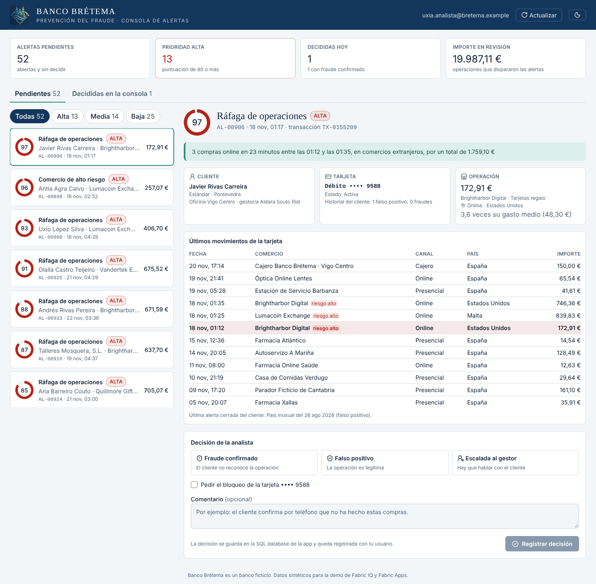
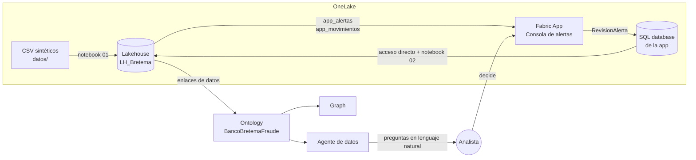

<p align="center">
  
</p>

# Banco Brétema · Prevención del fraude con Fabric IQ y Fabric Apps

Demo completa de **Microsoft Fabric** que une las dos piezas nuevas de la plataforma:

- **Ontology (Fabric IQ)** da significado de negocio a los datos de un banco: clientes, tarjetas, comercios, transacciones y alertas de fraude. Sobre ella, un **agente de datos** responde preguntas que recorren varias relaciones.
- **Fabric Apps** construye una aplicación web operativa, la **consola de alertas**, sobre esos mismos datos. La analista de fraude decide desde ella, y su decisión vuelve a OneLake y a la ontología.

**Banco Brétema** es un banco ficticio con sede histórica en Santiago de Compostela y oficinas en las cuatro provincias gallegas. Todos los datos son sintéticos: clientes, importes, comercios y operaciones son inventados y se generan con una semilla fija.

<p align="center">
  
  <br><em>La consola de alertas (Fabric App) con los datos sintéticos de la demo.</em>
</p>

## La historia que cuentan los datos

1. **Un punto de compromiso.** Entre el 3 y el 11 de octubre de 2026 alguien instaló un lector fraudulento en la **Gasolineira Ponte Alta**, en Vigo. Semanas después, muchas tarjetas que repostaron allí sufren ráfagas de compras online de madrugada en comercios extranjeros de alto riesgo. El motor antifraude genera alertas una a una. Lo que no ve es que todas esas tarjetas pasaron por la misma gasolinera: eso lo descubre el agente al recorrer la ontología.
2. **Falsos positivos en Portugal.** Los clientes de Pontevedra y Ourense compran en persona al otro lado de la frontera. La regla de «país inusual» los marca una y otra vez, y la mitad de las alertas cerradas son falsos positivos de este tipo.
3. **Fraude que la regla no vio.** Tres tarjetas comprometidas en Ponte Alta tienen compras fraudulentas sin ninguna alerta. Solo aparecen si se cruzan comercio, tarjeta, transacción y alerta.

## Arquitectura



| Pieza | Elemento de Fabric | Qué hace en la demo |
| --- | --- | --- |
| Datos | Lakehouse `LH_Bretema` | 8 tablas del banco y 2 tablas preparadas para la app |
| Significado | Ontology `BancoBretemaFraude` | 9 tipos de entidad y 12 relaciones enlazados al Lakehouse |
| Relaciones | Graph | Permite recorrer cliente → tarjeta → transacción → comercio |
| Preguntas | Agente de datos `AG_Bretema` | Responde en español con la ontología como fuente |
| Acción | Fabric App `Consola de alertas` | Lee alertas del Lakehouse y guarda las decisiones en su SQL database |
| Cierre del ciclo | Notebook `02_sincronizar_revisiones` | Lleva las decisiones al Lakehouse para que la ontología las vea |

## Estructura del repositorio

```text
├── README.md
├── LICENSE
├── assets/                         # Logo y captura de la consola
├── datos/                          # 8 CSV sintéticos (unos 14 MB)
├── scripts/
│   ├── generar_datos.py            # Genera los CSV (semilla fija)
│   └── comprobar_historia.py       # Comprueba las historias y calcula las respuestas del guion
├── notebooks/
│   ├── 01_cargar_lakehouse.ipynb   # CSV → tablas Delta + tablas para la app
│   └── 02_sincronizar_revisiones.ipynb  # Decisiones de la app → Lakehouse
├── ontologia/
│   ├── banco_bretema.ttl           # Ontología en Turtle para importar
│   └── README.md                   # Importar, enlazar datos, reglas, grafo y agente
├── app/                            # Fabric App (Rayfin, React + TypeScript)
│   └── README.md                   # Cómo desplegarla
└── docs/
    ├── configuracion-fabric.md     # Capacidad, región y ajustes del tenant
    ├── modelo-datos.md             # Tablas, columnas y diagrama
    └── guion-demo.md               # Guion minuto a minuto con preguntas y respuestas esperadas
```

## Puesta en marcha

Calcula una hora la primera vez. Los pasos detallados están en cada enlace.

1. **Prepara Fabric**: un área de trabajo con capacidad F y las previews activadas en el tenant. → [docs/configuracion-fabric.md](docs/configuracion-fabric.md)
2. **Carga los datos**: crea el Lakehouse `LH_Bretema`, importa `notebooks/01_cargar_lakehouse.ipynb` y ejecútalo. Descarga los CSV de este repositorio y comprueba las cifras al final.
3. **Crea la ontología**: crea un Ontology vacío, importa `ontologia/banco_bretema.ttl` y enlaza cada entidad con su tabla. → [ontologia/README.md](ontologia/README.md)
4. **Materializa el grafo y crea el agente de datos** con la ontología como fuente. → [ontologia/README.md](ontologia/README.md#6-grafo)
5. **Despliega la consola de alertas** con la CLI de Rayfin. → [app/README.md](app/README.md)
6. **Cierra el ciclo**: crea el acceso directo a la tabla `RevisionAlertas` de la app e importa `notebooks/02_sincronizar_revisiones.ipynb`.
7. **Ensaya la demo** con el guion. → [docs/guion-demo.md](docs/guion-demo.md)

## Requisitos

- Una capacidad de Fabric (F2 o superior, o una capacidad de prueba) en una región donde esté disponible Fabric Apps.
- Permisos de administrador de Fabric para activar los ajustes en preview, o alguien que los active.
- Node.js LTS (v20, v22 o v24) y npm para desplegar la app.
- Python 3.10 o superior, solo si quieres regenerar los datos o comprobar las cifras en local (`pip install pandas numpy`).

## Avisos

- **Ontology y Fabric Apps están en preview.** Los nombres de las opciones del portal pueden cambiar. Desde la FabCon de Barcelona de septiembre de 2026 hay una experiencia nueva de Ontology; la antigua se retira el 31 de enero de 2027. Esta demo usa la nueva.
- **No regeneres los datos sin necesidad.** El guion usa cifras concretas (53 alertas abiertas, 23 tarjetas comprometidas…). Si cambias `generar_datos.py`, ejecuta `scripts/comprobar_historia.py` y actualiza el guion.
- Los nombres de personas, empresas y comercios son inventados. Cualquier parecido con entidades reales es casual. Los comercios online extranjeros usan nombres ficticios.

## Licencia

[MIT](LICENSE). La carpeta `app/` parte de la plantilla de Fabric Apps (Rayfin) de Microsoft, también con licencia MIT.
