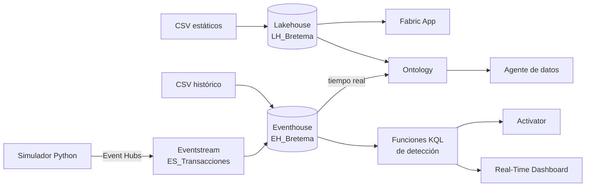

<p align="center">
  
</p>

# Banco Brétema · Prevención del fraude en tiempo real con Microsoft Fabric

Datos, simulador y guía para construir **paso a paso** una demo de Microsoft Fabric sobre un banco gallego ficticio:

- **Lakehouse** con los datos estáticos del banco: oficinas, gestores, clientes, cuentas, tarjetas y comercios.
- **Eventhouse** con seis meses de operaciones con tarjeta y alertas de fraude, consultados con **KQL**.
- **Simulador en tiempo real** que envía operaciones nuevas cada segundo a un **Eventstream**, con ráfagas de fraude, compras en Portugal e importes inusuales.
- **Real-Time Dashboard** y **Activator** para ver y avisar del fraude según ocurre.
- **Ontología (Fabric IQ)** y **agente de datos** para preguntar en lenguaje natural.
- **Fabric App** con una consola donde la analista decide sobre cada alerta.

**Banco Brétema** es un banco ficticio con sede histórica en Santiago de Compostela y oficinas en las cuatro provincias gallegas. Todos los datos son sintéticos: clientes, importes, comercios y operaciones son inventados.

## Empieza aquí

👉 **[Guía paso a paso](docs/paso-a-paso/README.md)**, de la preparación de la capacidad F2 a la Fabric App.

👉 **[Bitácora](docs/bitacora.md)** con lo que se ha hecho, las decisiones y lo pendiente.

## La historia que cuentan los datos

1. **Un punto de compromiso.** Entre el 3 y el 11 de octubre de 2026 alguien instaló un lector fraudulento en la **Gasolineira Ponte Alta**, en Vigo. Semanas después, muchas de las tarjetas que repostaron allí sufren ráfagas de compras online de madrugada en comercios extranjeros de alto riesgo. El motor antifraude genera alertas una a una, pero no ve lo que tienen en común. En el directo, el simulador sigue generando ráfagas en tarjetas que pasaron por allí.
2. **Falsos positivos en Portugal.** Los clientes de Pontevedra y Ourense compran en persona al otro lado de la frontera, y la regla de «país inusual» los marca una y otra vez: la mitad de las alertas cerradas son falsos positivos de este tipo.
3. **Fraude que la regla no vio.** Tres tarjetas comprometidas en Ponte Alta tienen compras fraudulentas sin ninguna alerta. Una consulta KQL las encuentra.

## Arquitectura



## Los datos

| CSV | Filas | Va a | Contenido |
| --- | ---: | --- | --- |
| `oficinas.csv` | 24 | Lakehouse y Eventhouse | Oficinas con municipio, provincia y coordenadas |
| `gestores.csv` | 48 | Lakehouse | Dirección y gestión de clientes de cada oficina |
| `clientes.csv` | 2.400 | Lakehouse y Eventhouse | Particulares, autónomos y empresas, con segmento y oficina |
| `cuentas.csv` | 3.194 | Lakehouse | Cuentas corrientes, nómina, ahorro y negocios |
| `tarjetas.csv` | 3.236 | Lakehouse y Eventhouse | Débito y crédito, enmascaradas (`**** 0120`), activas o bloqueadas |
| `comercios.csv` | 294 | Lakehouse y Eventhouse | Locales, online, Portugal y alto riesgo, con coordenadas |
| `transacciones.csv` | 161.462 | Eventhouse | Operaciones del 1 de junio al 24 de noviembre de 2026 |
| `alertas.csv` | 949 | Eventhouse | Alertas del motor antifraude: 53 abiertas y 896 cerradas |

Detalle de columnas y cómo se generaron: [docs/modelo-datos.md](docs/modelo-datos.md). Cómo funciona el simulador: [simulador/README.md](simulador/README.md).

## Estructura del repositorio

```text
├── datos/                      # Los 8 CSV
├── simulador/                  # Simulador en tiempo real, ejemplo de eventos y su documentación
├── kql/
│   ├── 01_tablas.kql           # Tablas, mapeo JSON y perfil de tarjetas
│   ├── 02_funciones.kql        # Ráfagas, alertas en tiempo real, punto de compromiso…
│   ├── 03_consultas_demo.kql   # Consultas de la demo con sus resultados esperados
│   ├── 04_panel_tiempo_real.kql          # Mosaicos del Real-Time Dashboard
│   └── 05_opcional_politica_actualizacion.kql
├── notebooks/
│   ├── 01_cargar_lakehouse.ipynb         # Alternativa a la carga manual
│   ├── 02_sincronizar_revisiones.ipynb   # Decisiones de la app → Lakehouse
│   └── 03_simulador_tiempo_real.ipynb    # El simulador, ejecutado desde Fabric
├── ontologia/                  # Ontología en Turtle y su guía
├── app/                        # Fabric App «Consola de alertas» (Rayfin)
├── scripts/                    # Generación y comprobación de los datos
├── docs/
│   ├── paso-a-paso/            # La guía, una fase por archivo
│   ├── bitacora.md             # Diario de la construcción de la demo
│   ├── modelo-datos.md
│   ├── guion-demo.md           # Guion para presentarla
│   └── configuracion-fabric.md
└── assets/                     # Logo y capturas
```

## Requisitos

- Una capacidad de Fabric. Con una **F2** basta; la guía indica cómo ahorrar consumo.
- Permisos de administración de Fabric para activar las previews de Ontology y Fabric Apps.
- Python 3.10 o superior y `pip install azure-eventhub` para el simulador.
- Node.js LTS, solo para la Fabric App.

## Avisos

- **Ontology y Fabric Apps están en preview**; los nombres de las opciones del portal pueden cambiar. Si encuentras diferencias, apúntalas en la bitácora.
- **No regeneres los datos sin necesidad.** La guía y las consultas usan cifras concretas. Si cambias `scripts/generar_datos.py`, ejecuta `scripts/comprobar_historia.py` y actualiza la documentación.
- **La cadena de conexión del Eventstream es una clave.** No la subas al repositorio.
- Los nombres de personas, empresas y comercios son inventados. Cualquier parecido con la realidad es casual.

## Licencia

[MIT](LICENSE). La carpeta `app/` parte de la plantilla de Fabric Apps (Rayfin) de Microsoft, también con licencia MIT.
