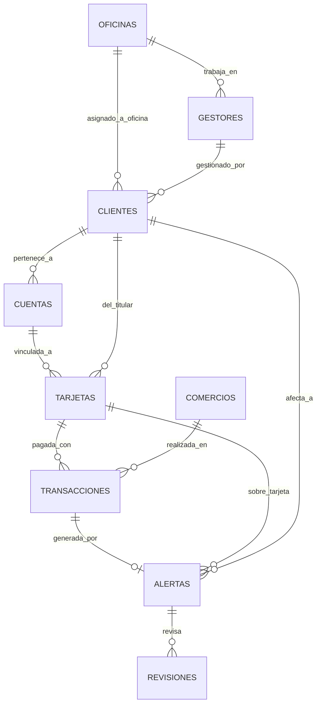

# Modelo de datos

Ocho tablas del banco, dos tablas preparadas para la Fabric App y la tabla de decisiones que vuelve de la app. Las seis tablas estáticas van al Lakehouse `Bretema_LH`; `transacciones` y `alertas`, al Eventhouse `EH_Bretema`, donde también llegan las operaciones del simulador. El histórico cubre del 1 de junio al 24 de noviembre de 2026.



## Tablas del banco

| Tabla | Filas | Clave | Columnas |
| --- | ---: | --- | --- |
| `oficinas` | 24 | `oficina_id` | nombre, municipio, provincia, tipo (Sede central, Urbana, Comarcal), latitud, longitud |
| `gestores` | 48 | `gestor_id` | nombre, rol (Director/a de oficina, Gestor/a de clientes), oficina_id |
| `clientes` | 2.400 | `cliente_id` | nombre, tipo_cliente, segmento, edad, municipio, provincia, fecha_alta, oficina_id, gestor_id, riesgo_kyc |
| `cuentas` | 3.194 | `cuenta_id` | cliente_id, tipo_cuenta, fecha_apertura, saldo_eur, estado |
| `tarjetas` | 3.236 | `tarjeta_id` | cuenta_id, cliente_id, tipo_tarjeta (Débito, Crédito), tarjeta_enmascarada (`**** 0120`), fecha_emision, fecha_caducidad, limite_eur, estado (Activa, Bloqueada), fecha_bloqueo |
| `comercios` | 294 | `comercio_id` | nombre, categoria, municipio, pais, canal (Presencial, Online, Cajero), nivel_riesgo (Bajo, Medio, Alto), latitud, longitud (vacías en los comercios online) |
| `transacciones` | 161.462 | `transaccion_id` | tarjeta_id, comercio_id, fecha_hora, importe_eur, canal, pais, resultado (Aprobada, Denegada) |
| `alertas` | 949 | `alerta_id` | transaccion_id, tarjeta_id, cliente_id, fecha_hora, tipo_alerta, motivo, puntuacion_riesgo, prioridad, estado (Abierta, Cerrada), resolucion (Fraude confirmado, Falso positivo), fecha_resolucion |

Detalles:

- Los importes son `DOUBLE` y no `DECIMAL`, porque el grafo de Fabric no admite `DECIMAL`.
- Las horas se guardan tal cual vienen en los CSV, sin zona horaria.
- De cada tarjeta solo se guardan los cuatro últimos dígitos, como texto (`**** 0120`) para que ningún asistente de carga los convierta en número y pierda los ceros. No hay números de tarjeta, IBAN ni documentos de identidad.
- Las coordenadas son las del municipio con una pequeña dispersión, para poder pintar mapas en KQL y en el Real-Time Dashboard.
- `segmento`: Joven, Estándar, Premium, Sénior, Autónomo o Empresa. Entre las empresas cliente está Conservas Ardora, la conservera de la demo de Claude Data.
- `tipo_alerta`: Ráfaga de operaciones, Comercio de alto riesgo, Operación nocturna online, País inusual e Importe inusual.
- `prioridad`: Alta si `puntuacion_riesgo` ≥ 80, Media entre 60 y 79, Baja por debajo de 60.
- Las alertas desde el 16 de noviembre siguen **abiertas** (53). Las anteriores están cerradas con su resolución.

## Tablas para la Fabric App

Las crea el notebook 01 cruzando las tablas del banco. La app las lee con el conector `bretema` (punto de conexión SQL de análisis, solo lectura). La ontología no las usa.

| Tabla | Filas | Contenido |
| --- | ---: | --- |
| `app_alertas` | 949 | Una fila por alerta con la transacción, el comercio, la tarjeta, el cliente, su oficina, su gestor y `gasto_medio_eur`: el gasto medio aprobado de la tarjeta en los 90 días anteriores |
| `app_movimientos` | 161.462 | Las transacciones con el nombre, la categoría, el municipio y el nivel de riesgo del comercio |

## Decisiones de la consola

| Dónde | Tabla | Columnas |
| --- | --- | --- |
| SQL database de la app | `dbo.RevisionAlertas` | id, alerta_id, decision, bloquear_tarjeta, comentario, analista_id, analista_email, revisada_en |
| Lakehouse (copia del notebook 02) | `revisiones` | revision_id, alerta_id, decision, bloquear_tarjeta, comentario, analista_email, revisada_en |

`decision` admite Fraude confirmado, Falso positivo o Escalada al gestor. La copia del Lakehouse no lleva `analista_id`, que es el identificador interno de la sesión.

## Cómo se generaron los datos

Todo sale de [`scripts/generar_datos.py`](../scripts/generar_datos.py), con la semilla fija 1902: cada ejecución produce exactamente los mismos CSV. Los pasos, en el orden del script:

1. **Oficinas y gestores.** 24 oficinas en las cuatro provincias, cada una con un peso según el tamaño de la ciudad (Vigo Centro y Santiago Centro, las que más clientes tienen). Dos personas por oficina: dirección y gestión de clientes.
2. **Clientes.** 2.400 clientes repartidos por oficina según esos pesos: un 86 % particulares, un 9 % autónomos y un 5 % empresas. Los nombres combinan nombres y apellidos gallegos al azar, sin repetir. El segmento depende de la edad (Joven por debajo de 30, Sénior desde 65, un 16 % de Premium en el resto). Las empresas salen de una lista inventada; entre ellas está Conservas Ardora.
3. **Cuentas y tarjetas.** Una o dos cuentas por cliente, según su tipo, con saldos de distribución lognormal. Las cuentas que no son de ahorro llevan tarjeta de débito (93 %) y, a veces, de crédito: el 90 % de los Premium, el 70 % de las empresas y el 30 % del resto.
4. **Comercios.** Cajeros del banco en cada oficina, comercios locales por municipio (supermercados, gasolineras, restaurantes, moda, farmacias, electrónica y joyerías), comercios presenciales en Portugal y fuera de Galicia, tiendas online españolas e internacionales y ocho comercios online de alto riesgo (tarjetas regalo y criptoactivos). Todos los nombres son inventados.
5. **Transacciones habituales.** Para cada tarjeta, un número de operaciones en seis meses según una distribución de Poisson: unas 9 al mes con débito y 5 con crédito, más con Premium y empresas. El comercio sale de unas proporciones fijas: sobre todo su municipio y su provincia, algo online, y compras en Portugal más frecuentes para los clientes de Pontevedra y Ourense. El importe sigue una lognormal centrada en la mediana de cada categoría.
6. **Historia 1, el punto de compromiso.** Se añaden repostajes en la Gasolineira Ponte Alta (Vigo) entre el 3 y el 11 de octubre para 46 tarjetas de la zona. De todas las que pasaron por allí esos días, 40 se eligen como comprometidas y sufren, entre el 19 de octubre y el 24 de noviembre, una ráfaga de 2 a 5 compras online de madrugada en cuatro comercios extranjeros de alto riesgo. A 4 de ellas el motor no las detecta.
7. **Fraude aislado.** 18 tarjetas al azar, sin relación con Ponte Alta, sufren fraudes sueltos repartidos por los seis meses, para que la historia de Ponte Alta no sea la única.
8. **Motor de reglas.** Se recorren las operaciones en orden y se generan alertas como lo haría un motor sencillo: ráfagas y compras fraudulentas detectadas; la primera compra presencial en Portugal en 60 días (un 35 % de las veces); compras legítimas en comercios de alto riesgo, y alguna compra de más de 6 veces el gasto habitual de la tarjeta. Para las operaciones legítimas, como mucho una alerta por tarjeta y día.
9. **Resolución.** Las alertas anteriores al 16 de noviembre se cierran entre 2 y 52 horas después: fraude confirmado si la operación era fraudulenta y falso positivo si no. Las posteriores siguen abiertas (53). Las tarjetas con fraude confirmado se bloquean y dejan de operar desde ese momento.
10. **Coordenadas.** Al final, y con un generador aleatorio aparte para no alterar nada de lo anterior, cada oficina y comercio presencial recibe las coordenadas de su municipio con una pequeña dispersión.

[`scripts/comprobar_historia.py`](../scripts/comprobar_historia.py) vuelve a leer los CSV, comprueba que las historias están ahí y calcula las cifras que usan la guía y el guion.

## Cómo regenerarlos

`scripts/generar_datos.py` crea los CSV con la semilla fija 1902, así que cada ejecución produce exactamente los mismos datos. `scripts/comprobar_historia.py` verifica las tres historias de la demo y calcula las respuestas del guion.

```bash
pip install pandas numpy
python scripts/generar_datos.py
python scripts/comprobar_historia.py
```
