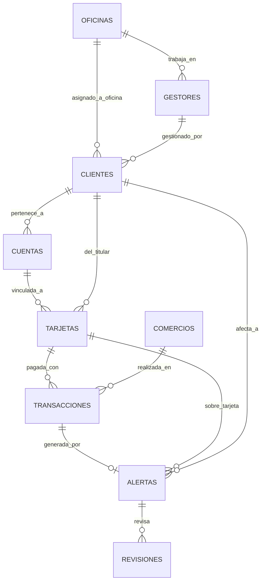

# Modelo de datos

Ocho tablas del banco, dos tablas preparadas para la Fabric App y la tabla de decisiones que vuelve de la app. Todas viven en el Lakehouse `LH_Bretema` (esquema `dbo`). Los datos cubren del 1 de junio al 24 de noviembre de 2026.



## Tablas del banco

| Tabla | Filas | Clave | Columnas |
| --- | ---: | --- | --- |
| `oficinas` | 24 | `oficina_id` | nombre, municipio, provincia, tipo (Sede central, Urbana, Comarcal) |
| `gestores` | 48 | `gestor_id` | nombre, rol (Director/a de oficina, Gestor/a de clientes), oficina_id |
| `clientes` | 2.400 | `cliente_id` | nombre, tipo_cliente, segmento, edad, municipio, provincia, fecha_alta, oficina_id, gestor_id, riesgo_kyc |
| `cuentas` | 3.194 | `cuenta_id` | cliente_id, tipo_cuenta, fecha_apertura, saldo_eur, estado |
| `tarjetas` | 3.236 | `tarjeta_id` | cuenta_id, cliente_id, tipo_tarjeta (Débito, Crédito), ultimos_digitos, fecha_emision, fecha_caducidad, limite_eur, estado (Activa, Bloqueada), fecha_bloqueo |
| `comercios` | 294 | `comercio_id` | nombre, categoria, municipio, pais, canal (Presencial, Online, Cajero), nivel_riesgo (Bajo, Medio, Alto) |
| `transacciones` | 161.462 | `transaccion_id` | tarjeta_id, comercio_id, fecha_hora, importe_eur, canal, pais, resultado (Aprobada, Denegada) |
| `alertas` | 949 | `alerta_id` | transaccion_id, tarjeta_id, cliente_id, fecha_hora, tipo_alerta, motivo, puntuacion_riesgo, prioridad, estado (Abierta, Cerrada), resolucion (Fraude confirmado, Falso positivo), fecha_resolucion |

Detalles:

- Los importes son `DOUBLE` y no `DECIMAL`, porque el grafo de Fabric no admite `DECIMAL`.
- Las horas se guardan tal cual vienen en los CSV, sin zona horaria.
- Solo se guardan los cuatro últimos dígitos de cada tarjeta. No hay números de tarjeta, IBAN ni documentos de identidad.
- `segmento`: Joven, Estándar, Premium, Sénior, Autónomo o Empresa. Entre las empresas cliente está Conservas Ardora, la conservera de la demo de Claude Data.
- `tipo_alerta`: Ráfaga de operaciones, Comercio de alto riesgo, Operación nocturna online, País inusual e Importe inusual.
- `prioridad`: Alta si `puntuacion_riesgo` ≥ 80, Media entre 60 y 79, Baja por debajo de 60.
- Las alertas desde el 16 de noviembre siguen **abiertas** (53). Las anteriores están cerradas con su resolución.

## Tablas para la Fabric App

Las crea el notebook 01 cruzando las tablas del banco. La app las lee con el conector `bretema` (punto de conexión SQL de análisis, solo lectura). La ontología no las usa.

| Tabla | Filas | Contenido |
| --- | ---: | --- |
| `app_alertas` | 949 | Una fila por alerta con la transacción, el comercio, la tarjeta, el cliente, su oficina, su gestor y `gasto_medio_eur`: el gasto medio aprobado de la tarjeta en los 90 días anteriores |
| `app_movimientos` | 161.462 | Las transacciones con el nombre, la categoría, el municipio y el nivel de riesgo del comercio |

## Decisiones de la consola

| Dónde | Tabla | Columnas |
| --- | --- | --- |
| SQL database de la app | `dbo.RevisionAlertas` | id, alerta_id, decision, bloquear_tarjeta, comentario, analista_id, analista_email, revisada_en |
| Lakehouse (copia del notebook 02) | `revisiones` | revision_id, alerta_id, decision, bloquear_tarjeta, comentario, analista_email, revisada_en |

`decision` admite Fraude confirmado, Falso positivo o Escalada al gestor. La copia del Lakehouse no lleva `analista_id`, que es el identificador interno de la sesión.

## Cómo se generan

`scripts/generar_datos.py` crea los CSV con la semilla fija 1902, así que cada ejecución produce exactamente los mismos datos. `scripts/comprobar_historia.py` verifica las tres historias de la demo y calcula las respuestas del guion.

```bash
pip install pandas numpy
python scripts/generar_datos.py
python scripts/comprobar_historia.py
```
