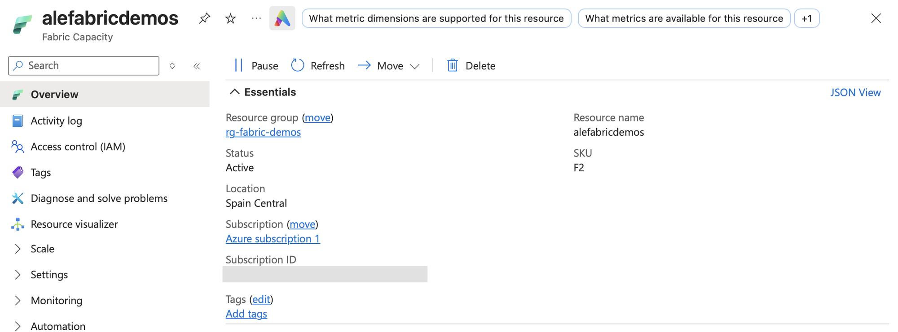
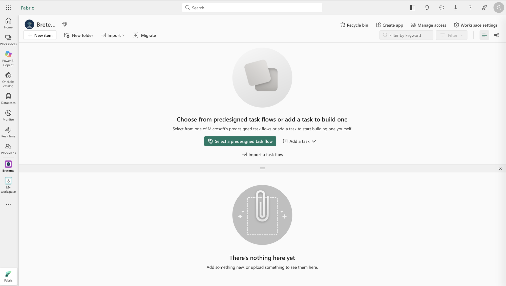

# Fase 0 · Preparación

## 1. Área de trabajo en la F2

1. **Áreas de trabajo › Nueva área de trabajo**, con el nombre `Bretema`.
2. En **Configuración avanzada › Modo de licencia**, elige **Capacidad de Fabric** y selecciona tu F2.
3. Comprueba que la F2 está **activa**: si la tienes pausada en Azure para ahorrar, reanúdala antes de empezar. En el portal de Azure, busca **Microsoft Fabric** y abre la capacidad: tiene que poner *Status: Active*. Desde ahí mismo se pausa al terminar (**Pause**).





### Si la opción «Fabric» sale en gris

Nos pasó al preparar la demo: en **Create a workspace** solo se podía elegir Power BI Pro, aunque la capacidad estaba activa y los permisos eran correctos. **Bastó con recargar la página de Fabric** y volver a abrir el panel. Si recargar no lo arregla, Fabric solo ofrece una capacidad a quien puede usarla, así que comprueba esto:

1. **La página.** Recarga Fabric, sobre todo si acabas de crear o reanudar la capacidad.
2. **La cuenta.** Fabric no admite cuentas personales (Outlook, Hotmail): hay que entrar con una cuenta profesional del mismo directorio que la suscripción de Azure donde está la F2. Si tienes varias cuentas, usa una ventana privada para no arrastrar otra sesión.
3. **La capacidad.** En **Portal de administración › Capacity settings › Fabric Capacity** tiene que aparecer la F2 con estado **Active** y tu cuenta entre sus administradores. Si no estás, añádete en el portal de Azure: la capacidad **› Settings › Capacity administrators**.

Si aun así no aparece, crea el área como Power BI Pro y asígnala desde el engranaje de la capacidad en **Capacity settings › Assign workspaces**, o desde **Configuración del área de trabajo › Información de licencia**.

## 2. Ajustes del tenant

Como administradora, en **Portal de administración › Configuración del inquilino** activa estos ajustes (puedes limitarlos a un grupo de seguridad en el que estés tú):

| Ajuste | Para qué fase |
| --- | --- |
| **Users can create Fabric items** | Todas |
| **Users can create ontology (preview) items** | 6 · Ontología |
| **Data agent item types (preview)** | 6 · Agente de datos |
| **Users can use Copilot and other features powered by Azure OpenAI** | 6 · Agentes |
| **Data sent to Azure OpenAI can be processed outside your capacity's geographic region…** | 6, solo si tu región no tiene Azure OpenAI |
| **Fabric Apps (preview)** | 7 · Fabric App |

Eventhouse, Eventstream, Real-Time Dashboard y Activator forman parte de Real-Time Intelligence y no necesitan ajustes en preview. Los cambios pueden tardar hasta una hora en aplicarse: actívalos antes de empezar, aunque la ontología y la app toquen más adelante.

## 3. Lo que necesitas en tu ordenador

| Herramienta | Para qué | Comprobación |
| --- | --- | --- |
| Python 3.10 o superior | Simulador (fase 3) | `python --version` |
| `pip install azure-eventhub` | Envío al Eventstream | `python -c "import azure.eventhub"` |
| Git o el zip del repositorio | Tener los CSV y los scripts a mano | |
| Node.js LTS (v20, v22 o v24) | Solo para la Fabric App (fase 7) | `node --version` |

## 4. Descarga el repositorio

```bash
git clone https://github.com/AbenFdez/Banco_Bretema_Prevencion_Fraude.git
cd Banco_Bretema_Prevencion_Fraude
```

Los CSV están en `datos/` y los scripts KQL en `kql/`.

## Comprobación

- [ ] El área de trabajo muestra el rombo de capacidad junto al nombre.
- [ ] En **Nuevo elemento** aparecen Lakehouse, Eventhouse, Eventstream y, si activaste las previews, Ontology y App.
- [ ] `python -c "import azure.eventhub"` no da error.

Apunta en la [bitácora](../bitacora.md) la región de tu capacidad y si algún ajuste tenía otro nombre.

Siguiente: [Fase 1 · Datos estáticos](01-lakehouse.md)
