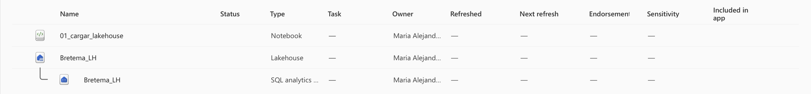
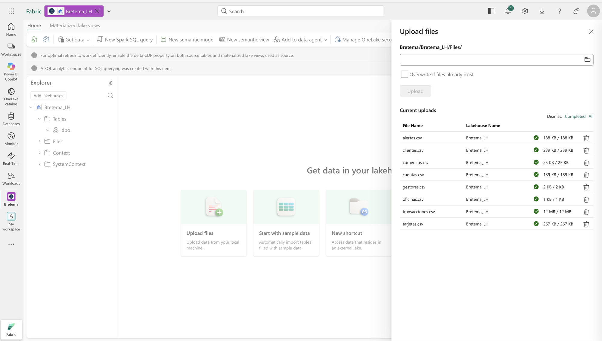
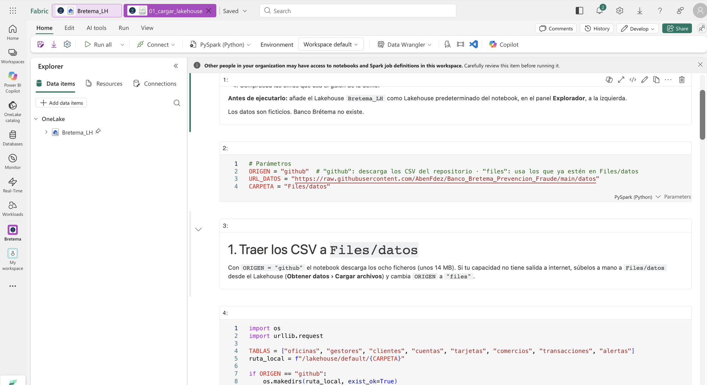
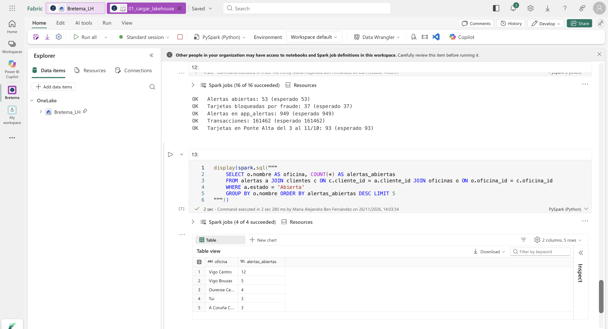

# Fase 1 · Datos estáticos en el Lakehouse

Los datos que cambian poco (oficinas, gestores, clientes, cuentas, tarjetas y comercios) van al Lakehouse como tablas Delta. Es lo que usarán la ontología, el grafo y la Fabric App.

## Pasos

Las tablas se crean con un notebook, porque así se fijan los tipos de cada columna, se crean también `transacciones` y `alertas` en Delta (las necesita la variante A de la ontología) y se preparan las tablas de la Fabric App. Hay dos notebooks que hacen lo mismo; elige uno:

| Notebook | Cómo lo hace |
| --- | --- |
| `01_crear_tablas_sql.ipynb` | Con SQL: un `CREATE TABLE` por tabla y un `INSERT … SELECT` desde el CSV. Una sentencia por celda |
| `01_cargar_lakehouse.ipynb` | Con PySpark: un bucle que lee los CSV y guarda las tablas. Puede descargar los CSV de GitHub |

### 1. Crear el Lakehouse y subir los CSV

1. En el área de trabajo, **Nuevo elemento › Lakehouse**, con el nombre `Bretema_LH`. Deja los esquemas activados: las tablas se crearán en `dbo`.
   Al crearlo, Fabric añade dos elementos con el mismo nombre: el **Lakehouse**, donde están los archivos y las tablas Delta, y su **punto de conexión de análisis SQL**, de solo lectura, que es el que consultará la Fabric App.

   

   La captura es posterior a importar el notebook del paso 2: por eso aparece también `01_cargar_lakehouse`.

2. Pulsa **Upload files** (o **Get data › Upload files**) y sube los ocho CSV de la carpeta `datos/` del repositorio. Quedan en `Files/`.



### 2. Importar el notebook

1. Abre la página del área de trabajo: pulsa **Bretema** en la barra de la izquierda y, en el panel que se despliega, el nombre **Bretema**. **Import** está en esa página, no dentro del Lakehouse.
2. **Import › Notebook › From this computer › Upload** y elige uno de los dos notebooks de la carpeta `notebooks/` del repositorio.
3. Abre el notebook y, en el panel **Explorer**, pulsa **Add data items**, elige el Lakehouse existente y marca `Bretema_LH` (el de tipo *Lakehouse*, no el punto de conexión SQL). Queda como Lakehouse predeterminado: lo indica la chincheta junto al nombre.



### 3. Crear las tablas

#### Opción A · Con `CREATE TABLE` (`01_crear_tablas_sql`)

**Run all**. No hay parámetros: lee los CSV de `Files/`. Cada celda es una sola sentencia de Spark SQL y cada tabla se crea en tres pasos. Para `oficinas`:

```sql
-- 1. Vista temporal sobre el CSV, con el tipo de cada columna
CREATE OR REPLACE TEMPORARY VIEW csv_oficinas (
    oficina_id STRING, nombre STRING, municipio STRING, provincia STRING, tipo STRING, latitud DOUBLE, longitud DOUBLE
)
USING csv
OPTIONS (path 'Files/oficinas.csv', header 'true', dateFormat 'yyyy-MM-dd', timestampFormat 'yyyy-MM-dd HH:mm:ss', quote '"', escape '"')

-- 2. La tabla Delta, con la clave NOT NULL
CREATE OR REPLACE TABLE oficinas (
    oficina_id STRING NOT NULL,
    nombre STRING,
    municipio STRING,
    provincia STRING,
    tipo STRING,
    latitud DOUBLE,
    longitud DOUBLE
) USING DELTA

-- 3. La carga
INSERT INTO oficinas
SELECT * FROM csv_oficinas
```

El `CREATE TABLE` se ejecuta en el notebook, con Spark SQL, y no en el punto de conexión de análisis SQL, que es de solo lectura para las tablas. Las tablas de la app se crean igual, con un `INSERT … SELECT` que cruza las del banco.

#### Opción B · Con PySpark (`01_cargar_lakehouse`)

El notebook recorre las ocho tablas en un bucle: lee cada CSV con su esquema y lo guarda como tabla Delta.

```python
df = spark.read.option("header", True).schema(ddl).csv(f"{CARPETA}/{tabla}.csv")
df.write.mode("overwrite").format("delta").saveAsTable(tabla)
```

En la primera celda de código, indica que los CSV ya están subidos y dónde:

```python
ORIGEN = "files"
CARPETA = "Files"
```

Si no has subido los CSV, deja los valores por defecto (`ORIGEN = "github"`): el notebook los descarga del repositorio a `Files/datos`. Después, **Run all**.

#### Al terminar

Pulsa **Stop session** para no consumir la F2. Con cualquiera de las dos opciones, en **Tables › dbo** tienen que aparecer once tablas: las ocho del banco, `app_alertas`, `app_movimientos` y `revisiones` (vacía). La última parte del notebook muestra las comprobaciones, que deben salir todas en `OK`.



Así terminó `01_cargar_lakehouse` en la F2 el 26 de noviembre: las cinco comprobaciones en `OK` y, debajo, las oficinas con más alertas abiertas (Vigo Centro 12, Vigo Bouzas 5, Ourense Centro 4, Tui 3 y A Coruña Centro 3).

### Alternativa sin notebook

Para cada CSV de `Files`: **… › Load to Tables › New table**. Deja el nombre propuesto, marca el encabezado como nombres de columna y el separador **coma**. Fabric infiere los tipos, así que revisa los que se indican en la comprobación. Con este camino no se crean las tablas de la app.

## Comprobación

En el Lakehouse, cambia a **Punto de conexión de análisis SQL** y ejecuta:

```sql
SELECT 'oficinas' AS tabla, COUNT(*) AS filas FROM dbo.oficinas UNION ALL
SELECT 'gestores', COUNT(*) FROM dbo.gestores UNION ALL
SELECT 'clientes', COUNT(*) FROM dbo.clientes UNION ALL
SELECT 'cuentas', COUNT(*) FROM dbo.cuentas UNION ALL
SELECT 'tarjetas', COUNT(*) FROM dbo.tarjetas UNION ALL
SELECT 'comercios', COUNT(*) FROM dbo.comercios;
```

| Tabla | Filas |
| --- | ---: |
| oficinas | 24 |
| gestores | 48 |
| clientes | 2.400 |
| cuentas | 3.194 |
| tarjetas | 3.236 |
| comercios | 294 |

Comprueba también los tipos: `tarjeta_enmascarada` debe ser texto (`**** 0120`), `latitud` y `longitud` números decimales, y `fecha_alta` una fecha.

## Qué apuntar en la bitácora

- Si **Cargar en tablas** infirió algún tipo distinto del esperado.
- Una captura de las tablas en el explorador, para la presentación. La de las cinco comprobaciones ya está.
- Cuánto tardó el notebook en la F2.

Siguiente: [Fase 2 · Histórico en el Eventhouse](02-eventhouse.md)
