# Fase 2 · Histórico en el Eventhouse

Las transacciones y las alertas son datos con fecha y hora que no paran de llegar: su sitio es un **Eventhouse**, que se consulta con **KQL**. Aquí se carga el histórico de seis meses; en la fase 3, las operaciones nuevas llegarán a la misma tabla.

Para cruzar en KQL las transacciones con el comercio, la tarjeta o el cliente, se cargan también en el Eventhouse cuatro de las tablas estáticas. Son pequeñas.

## 1. Crear el Eventhouse

1. **Nuevo elemento › Eventhouse**, con el nombre `Bretema_EH`. Fabric crea a la vez una base de datos KQL con el mismo nombre.

   

   Recién creado está vacío (0 B). En el panel de la izquierda, bajo **KQL databases**, aparece la base de datos `Bretema_EH`; en **Eventhouse Details**, la región de la capacidad.

2. En la configuración del Eventhouse, comprueba que **Disponibilidad siempre activa** (consumo mínimo) está **desactivada**, para no gastar capacidad de la F2 cuando no se usa.

## 2. Crear las tablas con sus tipos

Los comandos se ejecutan en el conjunto de consultas que Fabric crea junto con la base de datos, `Bretema_EH_queryset`.

1. **Llega al editor.** En el Eventhouse, panel de la izquierda, bajo **KQL databases**, pulsa la base de datos `Bretema_EH`: se despliegan `Bretema_EH_queryset`, **Tables**, **Shortcuts**, **Materialized views** y **Functions**. Pulsa `Bretema_EH_queryset`. Arriba queda marcada la pestaña **Queryset** y a la derecha se abre el editor. Si trae texto de ejemplo, bórralo.

   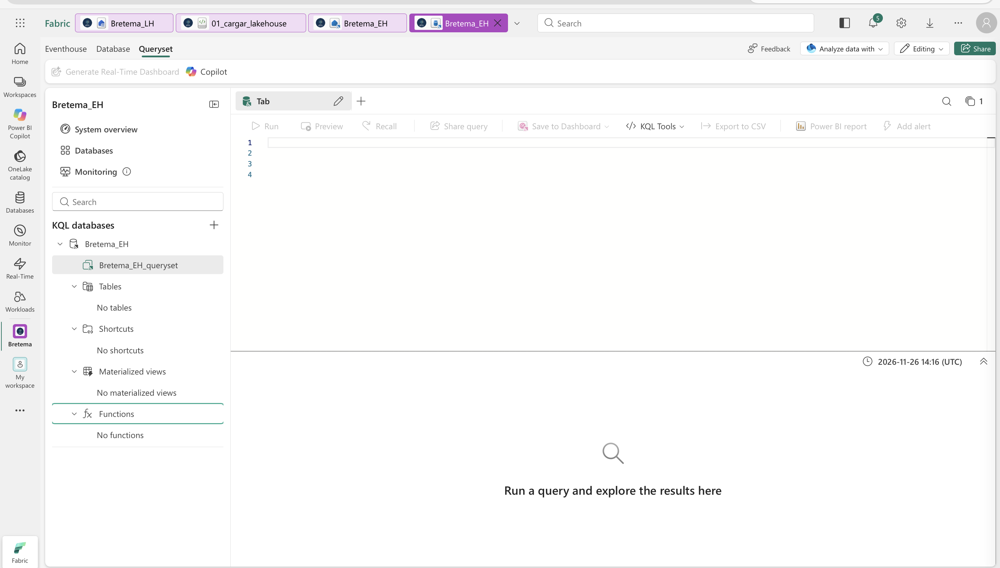

2. **Copia el script.** Dos formas de llevar [`kql/01_tablas.kql`](../../kql/01_tablas.kql) al portapapeles:
   - Desde la terminal, en la carpeta del repositorio (macOS):
     ```bash
     pbcopy < kql/01_tablas.kql
     ```
     No muestra nada: el archivo entero queda copiado. En Windows, `Get-Content kql/01_tablas.kql | Set-Clipboard` desde PowerShell.
   - Desde GitHub: abre la carpeta `kql`, el archivo `01_tablas.kql` y pulsa **Copy raw file**, el icono de los dos cuadrados que hay arriba a la derecha del contenido.
3. **Pégalo** en el editor del conjunto de consultas.
4. **Ejecuta, uno a uno**, los seis comandos `.create-merge table` y el comando del mapeo JSON: haz **un solo clic** dentro del comando, sin seleccionar texto, y pulsa **Run** (o Mayús + Intro). Abajo tiene que salir una tabla de resultado. No ejecutes todavía los dos últimos bloques del archivo.

   

   Al terminar, en **Tables** aparecen dos carpetas: **Banco** (`alertas`, `transacciones`) y **Referencia** (`clientes`, `comercios`, `oficinas`, `tarjetas`). Despliégalas con la flecha para comprobar que están las seis.

   

### Si sale un error

| Mensaje | Causa | Qué hacer |
| --- | --- | --- |
| `Syntax error: A recognition error occurred` | Había texto seleccionado y **Run** intentó ejecutar todo el archivo como una sola consulta | Haz clic en una zona vacía para quitar la selección y ejecuta los comandos uno a uno |
| `Semantic error: 'union' operator: Failed to resolve table expression named '…'` | Se ha ejecutado la consulta de comprobación antes de crear todas las tablas | Nada: no cambia nada. Sigue con los comandos que falten |
| `BadRequest_InvalidMapping` | El mapeo JSON estaba escrito en un formato que Fabric no acepta | Usa la versión actual de `kql/01_tablas.kql`, con la ruta dentro de `"Properties"` |
| No hay error, pero una tabla tiene filas de más o una columna vacía | Carga repetida, o columna `int` que el asistente desvía a otra con sufijo `_1` | [Comprobar la carga](#4-comprobar-la-carga) |

Repetir un `.create-merge table` ya ejecutado no duplica ni borra nada.

Crear antes las tablas evita que el asistente de carga cambie tipos; por ejemplo, que guarde `fecha_hora` como una fecha sin hora.

Los números enteros (`edad`, `puntuacion_riesgo`) se definen como `long`, no como `int`. El asistente lee los enteros de un CSV como `long` y, si la columna de la tabla es `int`, no avisa: crea otra columna con el sufijo `_1` y deja la original vacía. Nos pasó en la primera carga; está explicado en [Si una columna se carga vacía](#si-una-columna-se-carga-vacía).

## 3. Cargar los CSV

Empieza por `oficinas`, la más pequeña, para comprobar el asistente; después repite con las demás.

1. En el panel de la izquierda, pasa el ratón por la tabla, pulsa los tres puntos **…** y elige **Get data › Local file**.
2. El asistente tiene cuatro pasos, que se ven a la izquierda: **Source**, **Configure**, **Inspect** y **Summary**.
   - **Source / Configure:** comprueba que la tabla de destino es la correcta y sube el CSV de la carpeta `datos/` del repositorio.
   - **Inspect:** es la pantalla que hay que revisar antes de cargar. Comprueba cuatro cosas:
     - arriba, el destino: `Bretema_EH/` y el nombre de la tabla;
     - junto al nombre del archivo, el formato **CSV**;
     - el interruptor **First row header**, activado (en verde);
     - en la vista previa, que los nombres de las columnas son los de la tabla y que la primera fila es un dato (`CO-0001`), no los nombres de las columnas.

     

     Fabric propone un mapeo con el nombre de la tabla (`comercios_mapping`): déjalo como está.
   - **Summary:** al pulsar **Finish**, Fabric usa la tabla existente, crea un mapeo (`oficinas_mapping`) y carga el archivo. Tiene que acabar en **Successfully ingested**.

   

3. Pulsa **Close** y comprueba la carga en el conjunto de consultas, en una pestaña nueva:

   ```kql
   oficinas
   | summarize filas = count(), cabeceras = countif(oficina_id == "oficina_id")
   ```

   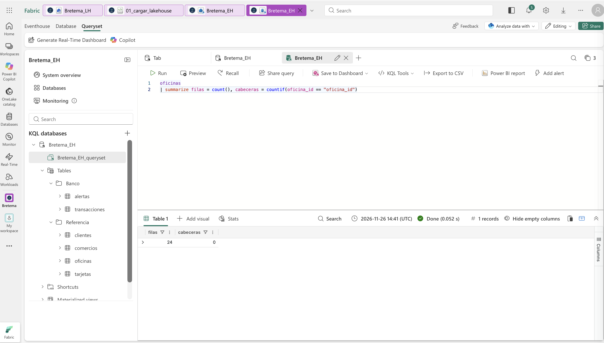

   Qué hace la consulta:
   - `oficinas` es la tabla de partida y `|` pasa su contenido al operador siguiente, como una tubería.
   - `summarize` resume todas las filas en una sola.
   - `filas = count()` cuenta las filas: tienen que ser las mismas que líneas de datos tiene el CSV, **24**.
   - `cabeceras = countif(oficina_id == "oficina_id")` cuenta las filas cuyo identificador es literalmente el texto `oficina_id`. Solo puede pasar si la primera línea del CSV, la de los nombres de columna, se ha cargado como un dato más. Tiene que ser **0**.

   Si sale `25` y `1`, el encabezado se ha cargado como una fila: en **Inspect** faltaba activar **First row header**. Vacía la tabla con `.clear table oficinas data` y repite la carga. Si sale `0` filas, la carga sigue en cola: espera un minuto y vuelve a ejecutar.

4. Repite los pasos 1 y 2 con las otras cinco tablas. `transacciones.csv` pesa 13 MB y tarda más. **Una carga por tabla**: el asistente no sustituye, añade. Si cargas dos veces el mismo CSV, la tabla queda con el doble de filas.

### Ver una tabla cargada

Pulsa una tabla en el panel de la izquierda para abrir su página (**Database / Tables / comercios**). Sirve para comprobar una carga de un vistazo, sin escribir una consulta:

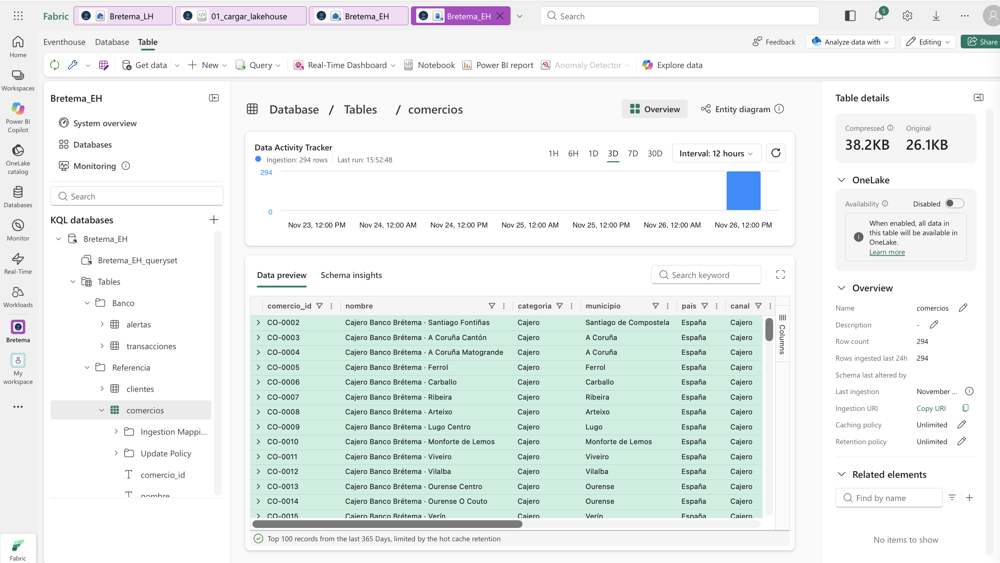

- **Data Activity Tracker:** las filas que han entrado y cuándo. Aquí, 294 de una vez.
- **Data preview:** las primeras filas. Los nombres completos y las tildes confirman que el CSV se ha leído bien.
- **Table details**, a la derecha: **Row count** (294, las del CSV), el tamaño y las políticas de caché y de retención.
- **OneLake › Availability:** aparece **Disabled**. Es el interruptor que publica la tabla en OneLake en formato Delta. No hace falta para consultar con KQL; se verá en la [fase 6](06-ontologia.md), porque la variante de la ontología que enlaza con el Eventhouse puede necesitarlo.
- En el panel de la izquierda, bajo la tabla: **Ingestion Mappings** (el mapeo que creó el asistente), **Update Policy** y las columnas con su tipo.

| Tabla | CSV | Filas |
| --- | --- | ---: |
| `transacciones` | `transacciones.csv` (13 MB) | 161.462 |
| `alertas` | `alertas.csv` | 949 |
| `comercios` | `comercios.csv` | 294 |
| `tarjetas` | `tarjetas.csv` | 3.236 |
| `clientes` | `clientes.csv` | 2.400 |
| `oficinas` | `oficinas.csv` | 24 |

## 4. Comprobar la carga

Las dos consultas están al final de [`kql/01_tablas.kql`](../../kql/01_tablas.kql). Ejecútalas en el conjunto de consultas.

**Comprobación 1 · Filas.** Cuenta las filas de cada tabla; tienen que coincidir con la tabla de arriba.

```kql
union withsource = tabla transacciones, alertas, comercios, tarjetas, clientes, oficinas
| summarize filas = count() by tabla
| order by tabla asc
```

- Si una tabla **no aparece**, está vacía: falta cargar su CSV.
- Si tiene **el doble o el triple**, el CSV se ha cargado más de una vez.
- Si tiene **una fila de más**, el encabezado se ha cargado como dato.

**Comprobación 2 · Tipos.** Que estén las filas no basta: una columna puede haberse cargado vacía. Esta consulta cuenta, para una columna de número o de fecha de cada tabla, cuántas filas tienen valor.

| columna | filas | con_valor |
| --- | ---: | ---: |
| alertas.puntuacion_riesgo (long) | 949 | 949 |
| clientes.edad (long) | 2.400 | 2.287 |
| comercios.latitud (real) | 294 | 256 |
| oficinas.latitud (real) | 24 | 24 |
| tarjetas.limite_eur (real) | 3.236 | 3.236 |
| transacciones.fecha_hora (datetime) | 161.462 | 161.462 |
| transacciones.importe_eur (real) | 161.462 | 161.462 |

Las 113 empresas no tienen edad y los 38 comercios online no tienen coordenadas. Un `0` en `con_valor` significa que la columna está vacía.

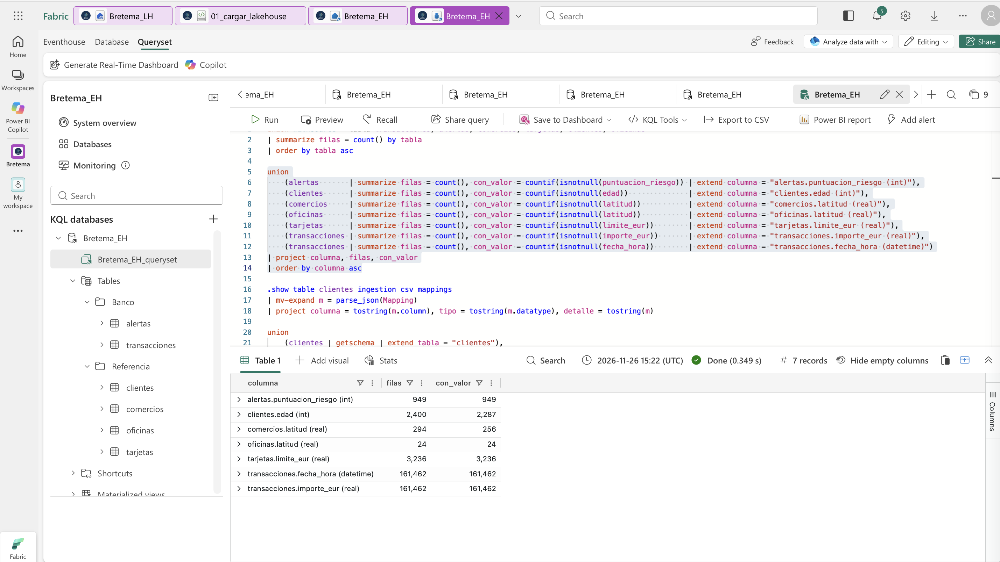

Así quedó el 26 de noviembre, después de los arreglos de abajo. En la captura las etiquetas dicen todavía `(int)`: son un texto fijo de la consulta de ese día; las dos columnas son ya `long`.

### Si una tabla tiene filas repetidas

Pasó con `comercios`, que llegó a tener 882 filas (tres cargas) en lugar de 294. Un comando sustituye el contenido de la tabla por sus filas sin repetir, sin volver al asistente:

```kql
.set-or-replace comercios <| comercios | distinct *
```

La otra opción es vaciar la tabla con `.clear table comercios data` y cargar el CSV una sola vez.

### Si una columna se carga vacía

Pasó en la primera carga con las dos columnas de número entero, que entonces eran `int`: `clientes.edad` y `alertas.puntuacion_riesgo`. Las filas estaban todas, pero la comprobación 2 daba `0`:

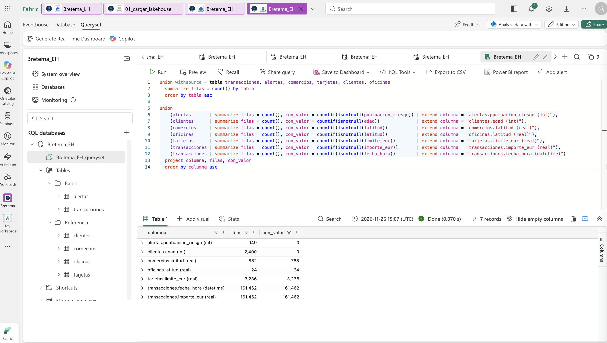

1. **Mira qué ha hecho el asistente con el CSV.** Cada carga crea un mapeo que dice a qué columna va cada posición del archivo:

   ```kql
   .show table clientes ingestion csv mappings
   | mv-expand m = parse_json(Mapping)
   | project columna = tostring(m.Name), posicion = tostring(m.Ordinal)
   ```

   La posición 4 del CSV, la edad, iba a una columna `edad_1`, no a `edad`:

   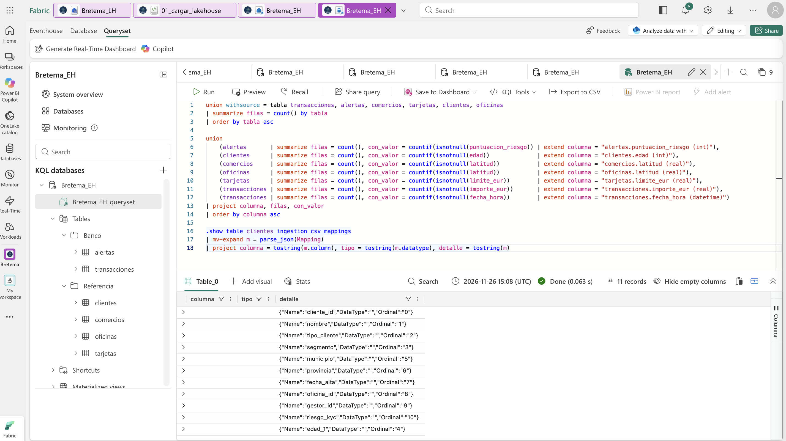

2. **Confirma las columnas y sus tipos:**

   ```kql
   clientes
   | getschema
   | where ColumnName has "edad"
   | project ColumnName, ColumnType
   ```

   Salían dos: `edad` (`int`, vacía) y `edad_1` (`long`, con los datos). El asistente lee los enteros como `long`; como no coincidía con el `int` de la tabla, creó una columna aparte.

3. **Arréglalo sin recargar:** borra la columna vacía y dale su nombre a la que tiene los datos. Un comando cada vez.

   ```kql
   .drop column clientes.edad

   .rename column clientes.edad_1 to edad
   ```

   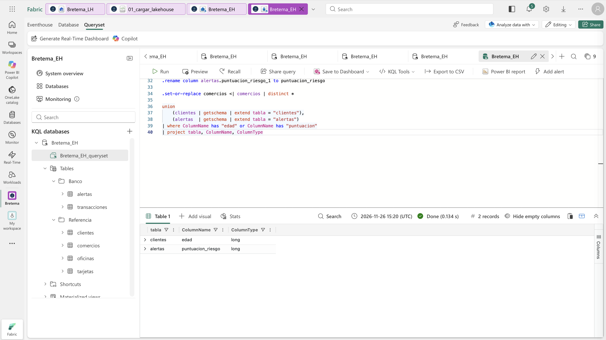

El script actual define ya esas columnas como `long`, que es el tipo que usa el asistente. Falta confirmarlo con una carga nueva.

## 5. Preparar la detección

1. **El perfil de cada tarjeta.** Ejecuta el comando `.set-or-replace perfil_tarjetas` del final de `kql/01_tablas.kql`. Recorre las transacciones aprobadas del histórico y guarda, para cada tarjeta, su gasto mediano, cuántas operaciones tiene y su última compra en el extranjero. Lo usan las reglas de importe inusual y de país inusual.

   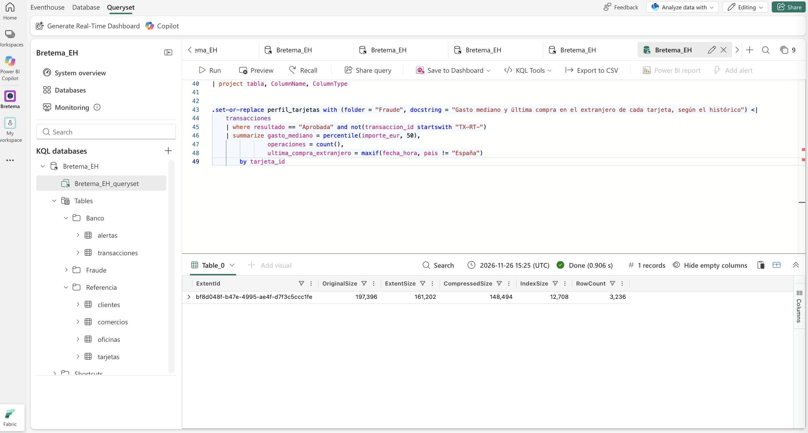

   El resultado no son los datos, sino el resumen de lo que se ha escrito: **RowCount 3.236**, una fila por tarjeta. En el panel aparece una carpeta nueva, **Fraude**, con la tabla. Tardó menos de un segundo. `.set-or-replace` sustituye el contenido, así que se puede repetir sin duplicar.

2. **Las funciones.** Copia [`kql/02_funciones.kql`](../../kql/02_funciones.kql) (`pbcopy < kql/02_funciones.kql`), pégalo en una pestaña nueva y ejecuta uno a uno los cinco `.create-or-alter function`. Aparecerán en **Functions › Fraude**:

   | Función | Qué devuelve |
   | --- | --- |
   | `fn_transacciones` | Las transacciones con el comercio, la tarjeta, el cliente y la oficina |
   | `fn_rafagas` | Varias compras online de una misma tarjeta separadas por menos de 15 minutos |
   | `fn_alertas_tiempo_real` | Las alertas calculadas al vuelo sobre las últimas operaciones |
   | `fn_punto_compromiso` | Los comercios donde coincidieron las tarjetas con fraude confirmado |
   | `fn_tarjetas_expuestas` | Las tarjetas que pasaron por un comercio en unas fechas |

   Ejecútalas en el orden del archivo: `fn_alertas_tiempo_real` usa `fn_rafagas`, así que esta tiene que existir antes.

   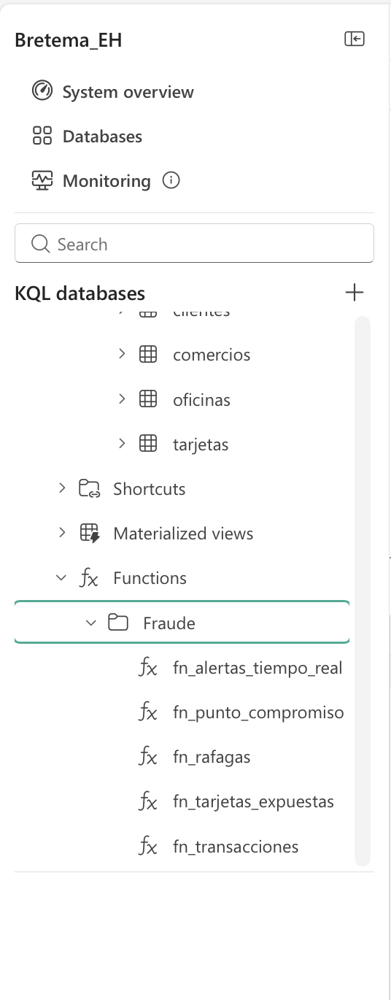

   Una función guarda una consulta con nombre dentro de la base de datos. Desde ese momento se usa como si fuera una tabla: `fn_rafagas()` o `fn_punto_compromiso(datetime(2026-10-15), datetime(2026-11-30))`. Las usarán las consultas de la demo, el panel en tiempo real y Activator.

   Si **Cmd + V** no pega nada en el editor, el portapapeles ya no tiene el script: una captura de pantalla o cualquier otra copia posterior lo sustituye. Repite el `pbcopy` y comprueba con `pbpaste | head -3` que muestra las primeras líneas del archivo.

## 6. Primeras consultas sobre el histórico

Prueba el bloque C de [`kql/03_consultas_demo.kql`](../../kql/03_consultas_demo.kql). Resultados esperados:

| Consulta | Resultado |
| --- | --- |
| C1 · Alertas por tipo y resolución | 949 alertas: 53 abiertas, 859 falsos positivos y 37 fraudes confirmados |
| C2 · Punto de compromiso | **Gasolineira Ponte Alta**: 23 de las 27 tarjetas con fraude confirmado desde el 15 de octubre (85,2 %). Las siguientes, 11 |
| C3 · Tarjetas que pasaron por Ponte Alta del 3 al 11 de octubre | 93 |
| C4 · Fraude sin alerta | 3 tarjetas y 5.217,18 € |
| C5 · Compras diarias en comercios de riesgo alto | Media de 1,6 al día de junio a septiembre y de 5,3 desde el 19 de octubre; pico de 17 el 7 de noviembre |
| C6 · País inusual | 469 alertas: 448 cerradas, todas falso positivo, y 21 abiertas |

**C2 es la consulta central de la historia.** Pregunta en qué comercios presenciales coincidieron, en los 60 días anteriores a su primera alerta, las tarjetas con fraude confirmado:

```kql
fn_punto_compromiso(datetime(2026-10-15), datetime(2026-11-30))
| take 10
```

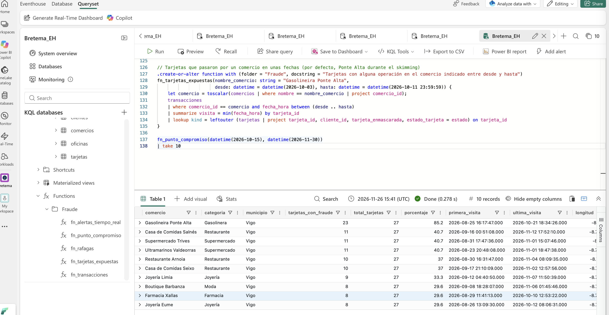

De las 27 tarjetas, **23 pasaron por la Gasolineira Ponte Alta (85,2 %)**. El siguiente comercio coincide en 11 (40,7 %): la diferencia es lo que señala a la gasolinera como punto de compromiso. Respondió en 0,3 segundos sobre 161.462 transacciones.

**C3 mide el alcance.** Si la gasolinera es el punto de compromiso, ¿cuántas tarjetas pasaron por allí en los días del fraude?

```kql
fn_tarjetas_expuestas()
| summarize tarjetas = count(), activas = countif(estado_tarjeta == "Activa"), bloqueadas = countif(estado_tarjeta == "Bloqueada")
```

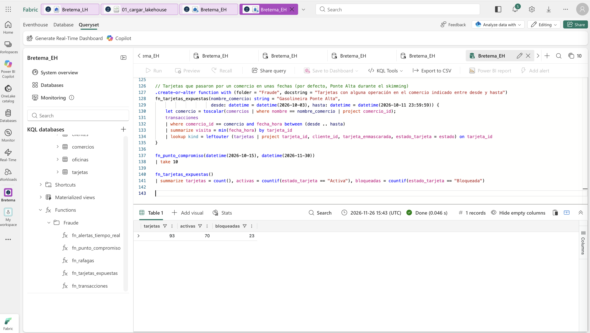

**93 tarjetas** pasaron por Ponte Alta del 3 al 11 de octubre. Las 23 bloqueadas son las que ya tienen fraude confirmado; las otras **70 siguen activas** y son las que hay que vigilar. La pregunta deja de ser «qué tarjetas han tenido fraude» y pasa a ser «qué tarjetas pueden tenerlo».

**C5 enseña que el histórico ya lo decía.** Cuenta por día las compras en comercios de riesgo alto y deja que KQL marque los días anómalos:

```kql
transacciones
| where fecha_hora between (datetime(2026-06-01) .. datetime(2026-11-25))
| lookup kind = leftouter (comercios | project comercio_id, nivel_riesgo) on comercio_id
| where nivel_riesgo == "Alto"
| make-series operaciones = count() default = 0 on fecha_hora from datetime(2026-06-01) to datetime(2026-11-25) step 1d
| extend anomalias = series_decompose_anomalies(operaciones, 2.5)
| render anomalychart with (anomalycolumns = anomalias)
```

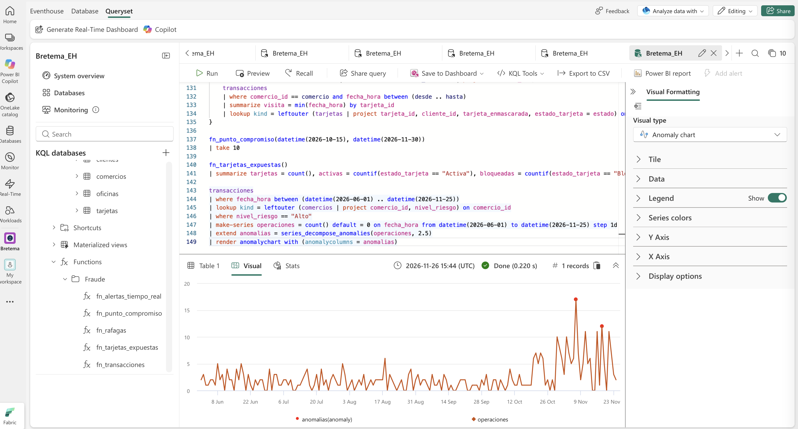

- `make-series` convierte las filas en una serie con un valor por día, y pone 0 en los días sin compras.
- `series_decompose_anomalies` separa la tendencia y el ruido de la serie y marca los puntos que se salen de lo esperado. El `2.5` es la sensibilidad.
- `render anomalychart` dibuja la serie y pone en rojo las anomalías. El resultado aparece en la pestaña **Visual**; a la derecha, **Visual Formatting** permite cambiar el tipo de gráfico.

De junio a mediados de octubre la línea se mueve entre 0 y 6 compras al día. Desde la segunda quincena de octubre se dispara, con un pico de **17 el 7 de noviembre**, marcado en rojo. Nadie miraba esta serie: el motor de reglas evaluaba cada operación por separado.

## Qué apuntar en la bitácora

- El tiempo que tardó la carga de `transacciones.csv` (el 26 de noviembre no se midió).
- Si las cifras de las consultas C coinciden.
- Capturas de C2 (punto de compromiso) y C5 (gráfico de anomalías): son dos buenos momentos de la demo.

Siguiente: [Fase 3 · Simulador en directo](03-eventstream-simulador.md)
