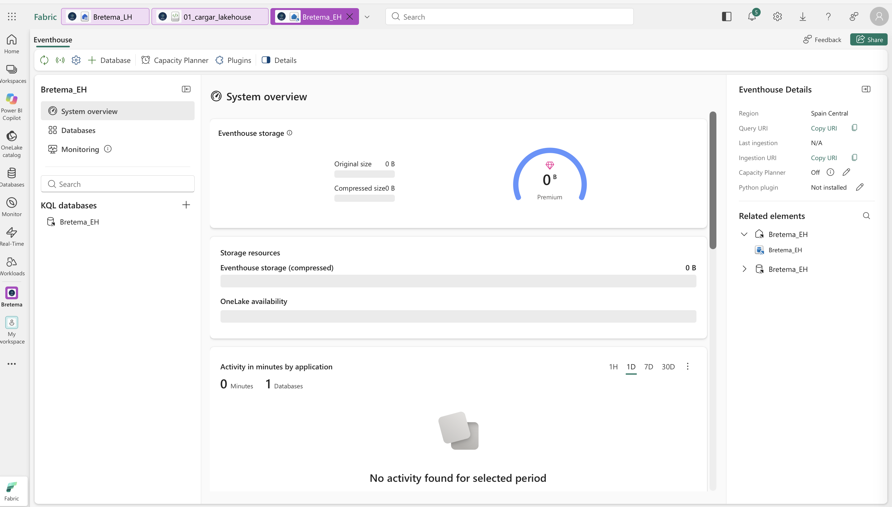
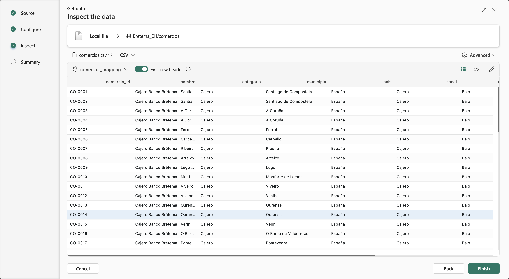
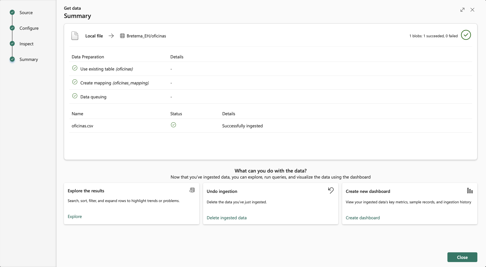

# Fase 2 · Histórico en el Eventhouse

Las transacciones y las alertas son datos con fecha y hora que no paran de llegar: su sitio es un **Eventhouse**, que se consulta con **KQL**. Aquí se carga el histórico de seis meses; en la fase 3, las operaciones nuevas llegarán a la misma tabla.

Para cruzar en KQL las transacciones con el comercio, la tarjeta o el cliente, se cargan también en el Eventhouse cuatro de las tablas estáticas. Son pequeñas.

## 1. Crear el Eventhouse

1. **Nuevo elemento › Eventhouse**, con el nombre `Bretema_EH`. Fabric crea a la vez una base de datos KQL con el mismo nombre.

   

   Recién creado está vacío (0 B). En el panel de la izquierda, bajo **KQL databases**, aparece la base de datos `Bretema_EH`; en **Eventhouse Details**, la región de la capacidad.

2. En la configuración del Eventhouse, comprueba que **Disponibilidad siempre activa** (consumo mínimo) está **desactivada**, para no gastar capacidad de la F2 cuando no se usa.

## 2. Crear las tablas con sus tipos

Los comandos se ejecutan en el conjunto de consultas que Fabric crea junto con la base de datos, `Bretema_EH_queryset`.

1. **Llega al editor.** En el Eventhouse, panel de la izquierda, bajo **KQL databases**, pulsa la base de datos `Bretema_EH`: se despliegan `Bretema_EH_queryset`, **Tables**, **Shortcuts**, **Materialized views** y **Functions**. Pulsa `Bretema_EH_queryset`. Arriba queda marcada la pestaña **Queryset** y a la derecha se abre el editor. Si trae texto de ejemplo, bórralo.

   

2. **Copia el script.** Dos formas de llevar [`kql/01_tablas.kql`](../../kql/01_tablas.kql) al portapapeles:
   - Desde la terminal, en la carpeta del repositorio (macOS):
     ```bash
     pbcopy < kql/01_tablas.kql
     ```
     No muestra nada: el archivo entero queda copiado. En Windows, `Get-Content kql/01_tablas.kql | Set-Clipboard` desde PowerShell.
   - Desde GitHub: abre la carpeta `kql`, el archivo `01_tablas.kql` y pulsa **Copy raw file**, el icono de los dos cuadrados que hay arriba a la derecha del contenido.
3. **Pégalo** en el editor del conjunto de consultas.
4. **Ejecuta, uno a uno**, los seis comandos `.create-merge table` y el comando del mapeo JSON: haz **un solo clic** dentro del comando, sin seleccionar texto, y pulsa **Run** (o Mayús + Intro). Abajo tiene que salir una tabla de resultado. No ejecutes todavía los dos últimos bloques del archivo.

   

   Al terminar, en **Tables** aparecen dos carpetas: **Banco** (`alertas`, `transacciones`) y **Referencia** (`clientes`, `comercios`, `oficinas`, `tarjetas`). Despliégalas con la flecha para comprobar que están las seis.

   

### Si sale un error

| Mensaje | Causa | Qué hacer |
| --- | --- | --- |
| `Syntax error: A recognition error occurred` | Había texto seleccionado y **Run** intentó ejecutar todo el archivo como una sola consulta | Haz clic en una zona vacía para quitar la selección y ejecuta los comandos uno a uno |
| `Semantic error: 'union' operator: Failed to resolve table expression named '…'` | Se ha ejecutado la consulta de comprobación antes de crear todas las tablas | Nada: no cambia nada. Sigue con los comandos que falten |
| `BadRequest_InvalidMapping` | El mapeo JSON estaba escrito en un formato que Fabric no acepta | Usa la versión actual de `kql/01_tablas.kql`, con la ruta dentro de `"Properties"` |

Repetir un `.create-merge table` ya ejecutado no duplica ni borra nada.

Crear antes las tablas evita que el asistente de carga cambie tipos; por ejemplo, que convierta `edad` en texto o `fecha_hora` en una fecha sin hora.

## 3. Cargar los CSV

Empieza por `oficinas`, la más pequeña, para comprobar el asistente; después repite con las demás.

1. En el panel de la izquierda, pasa el ratón por la tabla, pulsa los tres puntos **…** y elige **Get data › Local file**.
2. El asistente tiene cuatro pasos, que se ven a la izquierda: **Source**, **Configure**, **Inspect** y **Summary**.
   - **Source / Configure:** comprueba que la tabla de destino es la correcta y sube el CSV de la carpeta `datos/` del repositorio.
   - **Inspect:** es la pantalla que hay que revisar antes de cargar. Comprueba cuatro cosas:
     - arriba, el destino: `Bretema_EH/` y el nombre de la tabla;
     - junto al nombre del archivo, el formato **CSV**;
     - el interruptor **First row header**, activado (en verde);
     - en la vista previa, que los nombres de las columnas son los de la tabla y que la primera fila es un dato (`CO-0001`), no los nombres de las columnas.

     

     Fabric propone un mapeo con el nombre de la tabla (`comercios_mapping`): déjalo como está.
   - **Summary:** al pulsar **Finish**, Fabric usa la tabla existente, crea un mapeo (`oficinas_mapping`) y carga el archivo. Tiene que acabar en **Successfully ingested**.

   

3. Pulsa **Close** y comprueba la carga en el conjunto de consultas, en una pestaña nueva:

   ```kql
   oficinas
   | summarize filas = count(), cabeceras = countif(oficina_id == "oficina_id")
   ```

   

   Qué hace la consulta:
   - `oficinas` es la tabla de partida y `|` pasa su contenido al operador siguiente, como una tubería.
   - `summarize` resume todas las filas en una sola.
   - `filas = count()` cuenta las filas: tienen que ser las mismas que líneas de datos tiene el CSV, **24**.
   - `cabeceras = countif(oficina_id == "oficina_id")` cuenta las filas cuyo identificador es literalmente el texto `oficina_id`. Solo puede pasar si la primera línea del CSV, la de los nombres de columna, se ha cargado como un dato más. Tiene que ser **0**.

   Si sale `25` y `1`, el encabezado se ha cargado como una fila: en **Inspect** faltaba activar **First row header**. Vacía la tabla con `.clear table oficinas data` y repite la carga. Si sale `0` filas, la carga sigue en cola: espera un minuto y vuelve a ejecutar.

4. Repite los pasos 1 y 2 con las otras cinco tablas. `transacciones.csv` pesa 13 MB y tarda más.

### Ver una tabla cargada

Pulsa una tabla en el panel de la izquierda para abrir su página (**Database / Tables / comercios**). Sirve para comprobar una carga de un vistazo, sin escribir una consulta:


- **Data Activity Tracker:** las filas que han entrado y cuándo. Aquí, 294 de una vez.
- **Data preview:** las primeras filas. Los nombres completos y las tildes confirman que el CSV se ha leído bien.
- **Table details**, a la derecha: **Row count** (294, las del CSV), el tamaño y las políticas de caché y de retención.
- **OneLake › Availability:** aparece **Disabled**. Es el interruptor que publica la tabla en OneLake en formato Delta. No hace falta para consultar con KQL; se verá en la [fase 6](06-ontologia.md), porque la variante de la ontología que enlaza con el Eventhouse puede necesitarlo.
- En el panel de la izquierda, bajo la tabla: **Ingestion Mappings** (el mapeo que creó el asistente), **Update Policy** y las columnas con su tipo.

| Tabla | CSV | Filas |
| --- | --- | ---: |
| `transacciones` | `transacciones.csv` (13 MB) | 161.462 |
| `alertas` | `alertas.csv` | 949 |
| `comercios` | `comercios.csv` | 294 |
| `tarjetas` | `tarjetas.csv` | 3.236 |
| `clientes` | `clientes.csv` | 2.400 |
| `oficinas` | `oficinas.csv` | 24 |

## 4. Comprobar y preparar la detección

1. Ejecuta la consulta de comprobación del final de `kql/01_tablas.kql`: las filas deben coincidir con la tabla de arriba.
2. Ejecuta el comando `.set-or-replace perfil_tarjetas`: calcula el gasto mediano de cada tarjeta y su última compra en el extranjero, que usan las reglas de importe y país inusual.
3. Copia [`kql/02_funciones.kql`](../../kql/02_funciones.kql) y ejecuta uno a uno los cinco `.create-or-alter function`. Aparecerán en la carpeta **Funciones › Fraude** de la base de datos.

## 5. Primeras consultas sobre el histórico

Prueba el bloque C de [`kql/03_consultas_demo.kql`](../../kql/03_consultas_demo.kql). Resultados esperados:

| Consulta | Resultado |
| --- | --- |
| C1 · Alertas por tipo y resolución | 949 alertas: 53 abiertas, 859 falsos positivos y 37 fraudes confirmados |
| C2 · Punto de compromiso | **Gasolineira Ponte Alta**: 23 de las 27 tarjetas con fraude confirmado desde el 15 de octubre (85,2 %). Las siguientes, 11 |
| C3 · Tarjetas que pasaron por Ponte Alta del 3 al 11 de octubre | 93 |
| C4 · Fraude sin alerta | 3 tarjetas y 5.217,18 € |
| C5 · Compras diarias en comercios de riesgo alto | Media de 1,6 al día de junio a septiembre y de 5,3 desde el 19 de octubre; pico de 17 el 7 de noviembre |
| C6 · País inusual | 469 alertas: 448 cerradas, todas falso positivo, y 21 abiertas |

## Qué apuntar en la bitácora

- El tiempo que tardó la carga de `transacciones.csv`.
- Si las cifras de las consultas C coinciden.
- Capturas de C2 (punto de compromiso) y C5 (gráfico de anomalías): son dos buenos momentos de la demo.

Siguiente: [Fase 3 · Simulador en directo](03-eventstream-simulador.md)
