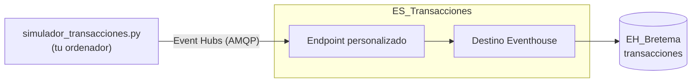

# Fase 3 · Simulador en directo con Eventstream

Un **Eventstream** recibe las operaciones que envía el simulador y las deja, segundo a segundo, en la tabla `transacciones` del Eventhouse. Cómo está hecho el simulador: [simulador/README.md](../../simulador/README.md).



## 1. Crear el Eventstream

1. **Nuevo elemento › Eventstream**, con el nombre `ES_Transacciones`.
2. **Agregar origen › Endpoint personalizado** (Custom endpoint). Nombre del origen: `simulador`. Pulsa **Agregar**.
3. **Agregar destino › Eventhouse**:
   - Modo de ingesta: **Ingesta directa** (Direct ingestion).
   - Área de trabajo `Bretema`, Eventhouse `EH_Bretema`, base de datos `EH_Bretema`.
   - Nombre del destino: `transacciones`.
4. Pulsa **Publicar**.
5. Con el Eventstream publicado, en el nodo del destino, pulsa **Configurar**: elige la **tabla existente** `transacciones` y, como formato, **JSON**. El asistente propone el mapeo con las ocho columnas; comprueba que `fecha_hora` es `datetime` e `importe_eur` es `real`. Si prefieres, elige el mapeo `transacciones_json` creado en la fase 2.

## 2. Copiar la cadena de conexión

1. Selecciona el nodo del origen `simulador` y abre **Detalles › Event Hub › Autenticación con clave SAS** (Keys).
2. Copia la **Cadena de conexión: clave principal**. Empieza por `Endpoint=sb://` y termina en `EntityPath=…`.

> Esa cadena es una clave de acceso: no la pegues en el repositorio ni en capturas.

## 3. Arrancar el simulador

En tu ordenador, desde la carpeta del repositorio:

```bash
# Prueba en seco, sin enviar nada
python simulador/simulador_transacciones.py --destino consola --duracion 1 --datos datos

# Envío al Eventstream durante 20 minutos
export EVENTSTREAM_CONEXION="Endpoint=sb://…;EntityPath=…"      # Windows: $env:EVENTSTREAM_CONEXION = "…"
python simulador/simulador_transacciones.py --destino eventstream --duracion 20 --datos datos
```

Verás algo así:

```text
Simulador en marcha: 2.0 operaciones por segundo durante 20.0 min. Ctrl+C para parar.
[19:31:24] RÁFAGA DE FRAUDE · 4 compras online por 2.074,41 € con la tarjeta TJ-000046 (**** 0313) de Talleres Mosquera, S.L., oficina Vigo Centro. Pasó por Ponte Alta en octubre.
[19:31:34] Compra en Portugal · 21,14 € en Tasca Bragança Velha (Porto) con la tarjeta TJ-001739 (**** 7798) de Eva Teijeiro Dopico, oficina Ourense O Couto
```

Alternativa sin ordenador: importa `notebooks/03_simulador_tiempo_real.ipynb`, cambia su lenguaje a **Python**, pega la cadena de conexión en la celda de parámetros y ejecútalo. Consume capacidad mientras la sesión está abierta.

## 4. Comprobar que llega

1. **Eventstream**: selecciona el nodo `simulador` › **Vista previa de datos**. Tienen que ir apareciendo eventos JSON.
2. **Eventhouse**: ejecuta la consulta A1 de [`kql/03_consultas_demo.kql`](../../kql/03_consultas_demo.kql). Con los valores por defecto, `ultimo_minuto` ronda las 120 operaciones y `retraso_segundos` debe ser de pocos segundos.
3. Cuando el simulador anuncie una ráfaga, ejecuta `fn_rafagas(15m)`: en menos de un minuto debe salir esa tarjeta.

## Qué apuntar en la bitácora

- La latencia real: el valor de `retraso_segundos` en A1.
- Si el asistente del destino creó un mapeo propio o usaste `transacciones_json`.
- Cualquier error del simulador al enviar, con su mensaje.

Siguiente: [Fase 4 · KQL y panel en directo](04-kql-panel.md)
