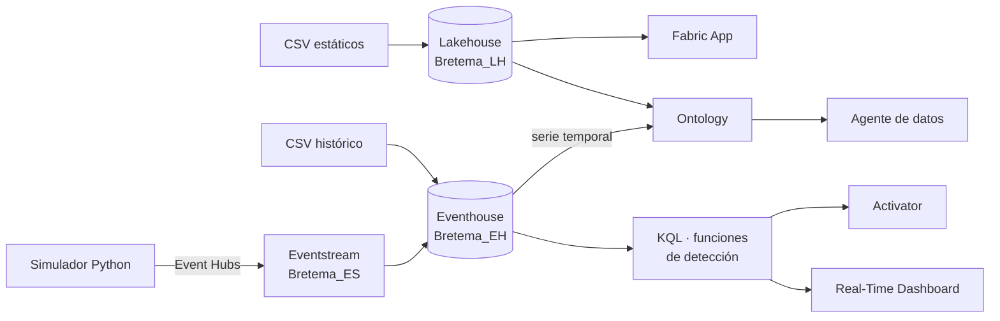

# Demo paso a paso

La demo se construye en fases. Cada fase tiene su archivo con lo que hay que hacer en el portal de Fabric, cómo comprobar que ha salido bien y qué apuntar en la [bitácora](../bitacora.md).

| Fase | Qué se construye | Elementos de Fabric | Tiempo |
| --- | --- | --- | --- |
| [0 · Preparación](00-preparacion.md) | Área de trabajo y ajustes del tenant en la F2 | Área de trabajo | 15 min |
| [1 · Datos estáticos](01-lakehouse.md) | Clientes, tarjetas, comercios… en tablas Delta | Lakehouse `Bretema_LH` | 15 min |
| [2 · Histórico en tiempo real](02-eventhouse.md) | Seis meses de transacciones y alertas, con KQL | Eventhouse `Bretema_EH` | 20 min |
| [3 · Simulador en directo](03-eventstream-simulador.md) | Operaciones nuevas cada segundo | Eventstream `Bretema_ES` | 20 min |
| [4 · KQL y panel en directo](04-kql-panel.md) | Detección de ráfagas y panel que se actualiza solo | Conjunto de consultas KQL, Real-Time Dashboard | 30 min |
| [5 · Alertas automáticas](05-activator.md) | Aviso cuando aparece una ráfaga | Activator | 15 min |
| [6 · Ontología y agente](06-ontologia.md) | Significado de negocio y preguntas en lenguaje natural | Ontology, Graph, agente de datos | 45 min |
| [7 · Fabric App](07-fabric-app.md) | Consola para que la analista decida | Fabric App | 30 min |

Las fases 0 a 4 son el núcleo de tiempo real. Las fases 5 a 7 se apoyan en ellas y se pueden hacer en otro momento.

## Nombres que usa toda la guía

| Elemento | Nombre |
| --- | --- |
| Área de trabajo | `Bretema` |
| Lakehouse | `Bretema_LH` |
| Eventhouse y su base de datos KQL | `Bretema_EH` |
| Eventstream | `Bretema_ES` |
| Conjunto de consultas KQL | `KQL_Fraude` |
| Real-Time Dashboard | `Fraude en directo` |
| Activator | `ACT_Rafagas` |
| Ontology | `BancoBretemaFraude` |
| Agente de datos | `AG_Bretema` |

Si cambias alguno, cámbialo también en los scripts KQL y en los notebooks.

## Capacidad F2

Una F2 da para toda la demo, pero conviene cuidar el consumo:

- **Eventhouse**: deja desactivada la opción de **disponibilidad siempre activa** (consumo mínimo). Tras un rato sin uso se suspende y vuelve a arrancar con la primera consulta, tardando unos segundos.
- **Simulador**: ejecútalo en tu ordenador. Un notebook de Fabric mantiene una sesión abierta que consume unidades de capacidad.
- **Real-Time Dashboard**: actualización automática cada 10 a 30 segundos solo mientras haces la demo; después, desactívala.
- **Grafo de la ontología**: no programes refrescos frecuentes.
- Si algo va lento, revisa la app **Microsoft Fabric Capacity Metrics**.
