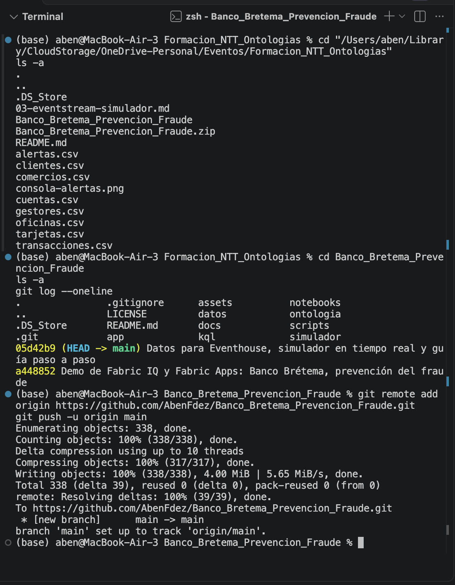

# Cómo publicamos el repositorio en GitHub

El repositorio se preparó con Claude, con su historial de commits, y se subió a GitHub desde la terminal de VS Code. Así se hizo y así se mantiene.

## 1. Crear el repositorio vacío en GitHub

En github.com › **New repository**: nombre `Banco_Bretema_Prevencion_Fraude`, público y **sin** README, `.gitignore` ni licencia, porque ya venían en el repositorio local.

## 2. Abrir la carpeta en VS Code

El repositorio llegó en un zip que ya incluía la carpeta `.git` con el historial. Se descomprimió en OneDrive, en `Eventos/Formacion_NTT_Ontologias`, y se abrió con **File › Open Folder…**.

> Cuidado con la terminal: si VS Code tiene abierta otra carpeta, la terminal arranca en ella. Comprueba siempre con `pwd` y `git log --oneline` que estás en el repositorio correcto antes de añadir un remoto o hacer `push`.

## 3. Comprobar y subir

```bash
cd "/Users/aben/Library/CloudStorage/OneDrive-Personal/Eventos/Formacion_NTT_Ontologias"
cd Banco_Bretema_Prevencion_Fraude
ls -a                 # tiene que aparecer .git
git log --oneline     # los commits del repositorio
git remote add origin https://github.com/AbenFdez/Banco_Bretema_Prevencion_Fraude.git
git push -u origin main
```



El `push` subió 338 objetos (4 MB comprimidos) y creó la rama `main` en GitHub, enlazada con la local (`branch 'main' set up to track 'origin/main'`).

## 4. Cómo se actualiza

Cada cambio que prepara Claude llega como un archivo `.patch`. Se aplica y se sube desde la carpeta del repositorio:

```bash
git am ruta/al/archivo.patch
git push
```

`git am` crea el commit con su descripción original, así que el historial de GitHub cuenta cómo se ha ido construyendo la demo.

### Si algo falla

| Mensaje | Qué hacer |
| --- | --- |
| `remote origin already exists` | Ya está conectado. Pasa directamente a `git push` |
| `rejected … fetch first` | GitHub tiene commits que no están en local. `git pull --rebase` y después `git push` |
| `patch does not apply` | El parche se generó sobre otra versión. Avisa a Claude con la salida de `git log --oneline` |
| `index.lock` o archivos bloqueados | OneDrive estaba sincronizando. Espera a que termine y repite |
