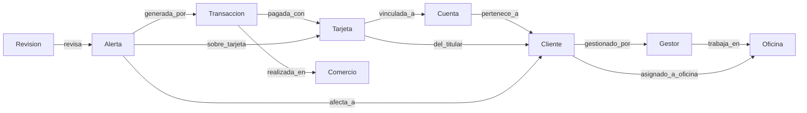

# Ontología `BancoBretemaFraude`

La ontología describe el negocio del banco con los términos que usa el equipo de fraude. Los datos se quedan en el Lakehouse: la ontología solo los enlaza. Sobre ella trabajan el grafo y el agente de datos.



Antes de empezar tienen que estar hechas las fases 1 y 2 de la [guía paso a paso](../docs/paso-a-paso/README.md): las tablas estáticas en el Lakehouse `Bretema_LH` y el histórico en el Eventhouse `EH_Bretema`. Se sigue el patrón del tutorial de Microsoft: entidades estáticas desde el Lakehouse y las que llegan en tiempo real desde el Eventhouse.

## 1. Crear el elemento

En el área de trabajo, **Nuevo elemento › Ontology (preview)**, con el nombre `BancoBretemaFraude`. Si no aparece o da error, revisa los ajustes del tenant en [docs/configuracion-fabric.md](../docs/configuracion-fabric.md).

## 2. Importar las entidades y relaciones

1. Con la ontología **vacía**, elige **Import ontology**. La importación solo funciona en una ontología sin contenido.
2. Selecciona `banco_bretema.ttl` y **Start import**.
3. Revisa el resumen antes de cerrarlo, porque no se puede volver a abrir. Puedes descargar el registro en JSON o CSV.

Tienes que ver **9 tipos de entidad** (Oficina, Gestor, Cliente, Cuenta, Tarjeta, Comercio, Transaccion, Alerta y Revision) y **12 tipos de relación**, con sus descripciones y sinónimos («movimiento», «sucursal», «decisión»…).

El archivo no trae propiedades: aparecen en el paso siguiente, con el nombre y el tipo de cada columna. Los nombres van sin tildes para evitar errores de validación; las formas con tilde están como sinónimos.

## 3. Enlazar cada entidad con su tabla

Para cada fila de la tabla:

1. En el **Explorador**, selecciona la entidad, pulsa **…** y **Bind data**. Si la entidad no tiene propiedades, la opción se llama **Add properties from data**.
2. En **Data sources**, pulsa **+ › OneLake catalog** y abre el origen de la tabla siguiente: `Bretema_LH › Schemas › dbo` para el Lakehouse o la base de datos KQL `EH_Bretema` para el Eventhouse. Si al enlazar una tabla del Eventhouse te pide una columna de marca de tiempo, elige `fecha_hora`.
3. En **Entity type › Properties** aparecen las columnas como propiedades propuestas. Déjalas todas con su nombre y pulsa **Create**.
4. En **Configure**, elige la **clave de la entidad** (entity type key): la propiedad que indica la columna «Clave» de la tabla siguiente. Todas son de texto.

| Entidad | Origen | Tabla | Clave |
| --- | --- | --- | --- |
| Oficina | Lakehouse | `oficinas` | `oficina_id` |
| Gestor | Lakehouse | `gestores` | `gestor_id` |
| Cliente | Lakehouse | `clientes` | `cliente_id` |
| Cuenta | Lakehouse | `cuentas` | `cuenta_id` |
| Tarjeta | Lakehouse | `tarjetas` | `tarjeta_id` |
| Comercio | Lakehouse | `comercios` | `comercio_id` |
| Transaccion | **Eventhouse** | `transacciones` (histórico y tiempo real) | `transaccion_id` |
| Alerta | **Eventhouse** | `alertas` | `alerta_id` |
| Revision | Lakehouse | `revisiones` (solo con la Fabric App) | `revision_id` |

No enlaces `app_alertas` ni `app_movimientos`: son tablas cruzadas para la app y duplicarían conceptos. Revision se enlaza cuando existe la tabla `revisiones`, que crea el notebook `01_cargar_lakehouse` (fase 7 de la guía).

**Alternativa con todo en el Lakehouse:** si ejecutaste el notebook 01, el Lakehouse también tiene `transacciones` y `alertas`. Enlazarlas allí permite meterlas en el grafo, pero sin las operaciones en tiempo real.

Las propiedades que se repiten entre entidades (`nombre`, `estado`, `municipio`, `fecha_hora`…) tienen siempre el mismo tipo, así que no hay conflictos.

## 4. Configurar las relaciones

Las relaciones ya existen tras la importación; falta decir qué propiedad de cada lado las une. Para cada una: selecciónala en el **Explorador**, abre su configuración, despliega **Property 1** en el origen y en el destino, elige las propiedades y pulsa **Save**.

| Relación | Origen (propiedad) | Destino (propiedad) |
| --- | --- | --- |
| `trabaja_en` | Gestor (`oficina_id`) | Oficina (`oficina_id`) |
| `asignado_a_oficina` | Cliente (`oficina_id`) | Oficina (`oficina_id`) |
| `gestionado_por` | Cliente (`gestor_id`) | Gestor (`gestor_id`) |
| `pertenece_a` | Cuenta (`cliente_id`) | Cliente (`cliente_id`) |
| `vinculada_a` | Tarjeta (`cuenta_id`) | Cuenta (`cuenta_id`) |
| `del_titular` | Tarjeta (`cliente_id`) | Cliente (`cliente_id`) |
| `pagada_con` | Transaccion (`tarjeta_id`) | Tarjeta (`tarjeta_id`) |
| `realizada_en` | Transaccion (`comercio_id`) | Comercio (`comercio_id`) |
| `generada_por` | Alerta (`transaccion_id`) | Transaccion (`transaccion_id`) |
| `sobre_tarjeta` | Alerta (`tarjeta_id`) | Tarjeta (`tarjeta_id`) |
| `afecta_a` | Alerta (`cliente_id`) | Cliente (`cliente_id`) |
| `revisa` | Revision (`alerta_id`) | Alerta (`alerta_id`) |

Si al configurar una relación faltan claves, es que alguna de las dos entidades no tiene clave elegida (paso 3.4).

### Alternativa: hacerlo con el agente de la ontología

El agente de la ontología (**Inicio › Ontology agent**) puede proponer los enlaces. Trabaja en modo **Plan** y aplica en modo **Act**. Úsalo con una o dos entidades cada vez y revisa la propuesta antes de aplicarla. Ejemplo:

```text
Bind the entity type Tarjeta to the table dbo.tarjetas in the lakehouse Bretema_LH of this workspace.
Use all columns as properties with the same names and use tarjeta_id as the entity type key.
Then configure the relationship vinculada_a from Tarjeta (cuenta_id) to Cuenta (cuenta_id).
```

Cambia a **Act** y escribe `Apply the plan`. Es una buena forma de enseñar el agente en la demo, pero para preparar la ontología completa los pasos manuales son más previsibles.

## 5. Reglas de negocio

Las reglas son definiciones en lenguaje natural que se enlazan a entidades y relaciones. La ontología no las ejecuta: son contexto para los agentes y las aplicaciones que la consultan (por ejemplo, con la herramienta MCP `list_ontology_rules`). Créalas en **Inicio › + Add › Rule**, con el nombre, la definición y los elementos enlazados.

**Posible punto de compromiso**
- Definición: Si varias tarjetas con fraude confirmado coinciden en el mismo comercio presencial durante las semanas anteriores al fraude, ese comercio es un posible punto de compromiso y hay que revisar todas las tarjetas que pasaron por él en esas fechas.
- Enlaces: Comercio, Transaccion, Tarjeta, Alerta; relaciones `realizada_en`, `pagada_con`.
- Metadatos: `categoria: fraude-tarjetas`

**Compras presenciales en Portugal**
- Definición: Una compra presencial en Portugal de un cliente con domicilio en Galicia no es por sí sola un indicio de fraude. En los últimos seis meses todas las alertas de País inusual por compras en Portugal se cerraron como falso positivo.
- Enlaces: Alerta, Transaccion, Comercio, Cliente.
- Metadatos: `categoria: falsos-positivos`

**Bloqueo tras fraude confirmado**
- Definición: Cuando una analista registra una revisión de Fraude confirmado con bloquear_tarjeta, la tarjeta de la alerta debe quedar bloqueada. Una tarjeta en estado Activa con una revisión así está pendiente de bloqueo.
- Enlaces: Revision, Alerta, Tarjeta; relaciones `revisa`, `sobre_tarjeta`.
- Metadatos: `categoria: operaciones`

**Prioridad de las alertas**
- Definición: Una alerta tiene prioridad Alta si su puntuación de riesgo es 80 o más, Media si está entre 60 y 79 y Baja si es menor de 60. Las alertas de prioridad Alta se revisan el mismo día.
- Enlaces: Alerta (propiedades `puntuacion_riesgo` y `prioridad`).

## 6. Grafo

El grafo es opcional en la ontología, pero lo necesitan las preguntas que recorren varias relaciones (cliente → tarjeta → transacción → comercio).

1. **Inicio › Administrar › Graph**. Espera a que termine **Review validation**. Las entidades del Lakehouse deben salir como aptas; Transaccion y Alerta, enlazadas al Eventhouse, salen como no aptas porque el grafo solo admite tablas Delta de Lakehouse o de bases de datos reflejadas. Es lo esperado.
2. **Select entities**: marca las entidades aptas y sus relaciones, **Continue** y **Materialize**. Con estos datos tarda pocos minutos.
3. Espera a **Graph materialized** y a que la actualización esté **Complete**.

**Después de cada cambio en los datos** (por ejemplo, tras ejecutar el notebook 02) hay que actualizar el grafo: en **Inicio › Administrar › Graph**, icono de actualizar de **Last refresh › Continue**. También se puede programar desde el área de trabajo, en el elemento de grafo: **… › Schedule**. No programes refrescos muy frecuentes: consumen capacidad.

## 7. Agente de datos

1. **Nuevo elemento › Data agent**, con el nombre `AG_Bretema`.
2. **Add a data source**, busca `BancoBretemaFraude` y **Add**.
3. En **Agent instructions** pega estas instrucciones. La primera línea es la que recomienda Microsoft para que las agregaciones funcionen con la ontología.

```text
Support group by in GQL

Eres el asistente del equipo de prevención del fraude de Banco Brétema, un banco con oficinas en Galicia.
Responde siempre en español de España, con frases cortas, y da cifras exactas.
Vocabulario:
- "Alerta abierta" o "pendiente" es una Alerta con estado = 'Abierta'.
- "Fraude confirmado" y "falso positivo" son valores de Alerta.resolucion (alertas cerradas) o de Revision.decision (decisiones de la consola).
- "Decisiones de la consola" o "revisiones" son las entidades Revision; revisada_en es la fecha de la decisión.
- Los importes están en euros (importe_eur).
- "Punto de compromiso" es un comercio por el que pasaron muchas tarjetas que después sufrieron fraude.
Cuando hables de un cliente, di también su oficina. Cuando hables de una tarjeta, da solo sus cuatro últimos dígitos.
Si una pregunta no se puede responder con los datos, dilo en lugar de suponer.
```

4. Prueba las preguntas del [guion](../docs/guion-demo.md). Si las primeras dan «no data», espera unos minutos a que el agente termine de inicializarse.

## Problemas frecuentes

| Síntoma | Causa probable |
| --- | --- |
| La importación no deja seleccionar el archivo | La ontología no está vacía. Crea otra. |
| El detalle de una entidad no muestra datos | Falta acceso al Lakehouse, o la tabla se renombró después de enlazarla. |
| El grafo sale vacío o incompleto | Alguna entidad no tiene clave o está sin enlazar. |
| Las agregaciones del agente no cuadran | Falta `Support group by in GQL` en las instrucciones. |
| El agente no ve las decisiones de la consola | No se ejecutó el notebook 02 o no se actualizó el grafo después. |
| Errores de lenguaje natural en el agente | Dos relaciones con el mismo nombre. En esta ontología todos son distintos. |

Más ayuda: [solución de problemas de ontology](https://learn.microsoft.com/fabric/iq/ontology/resources-troubleshooting).
